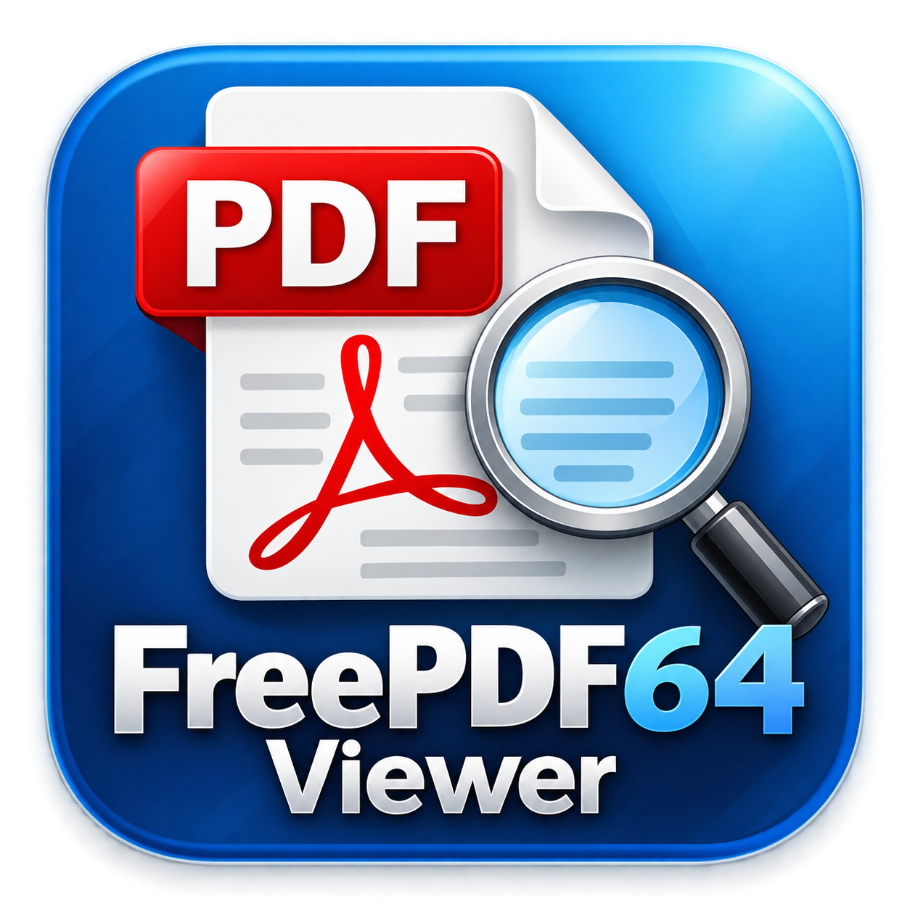
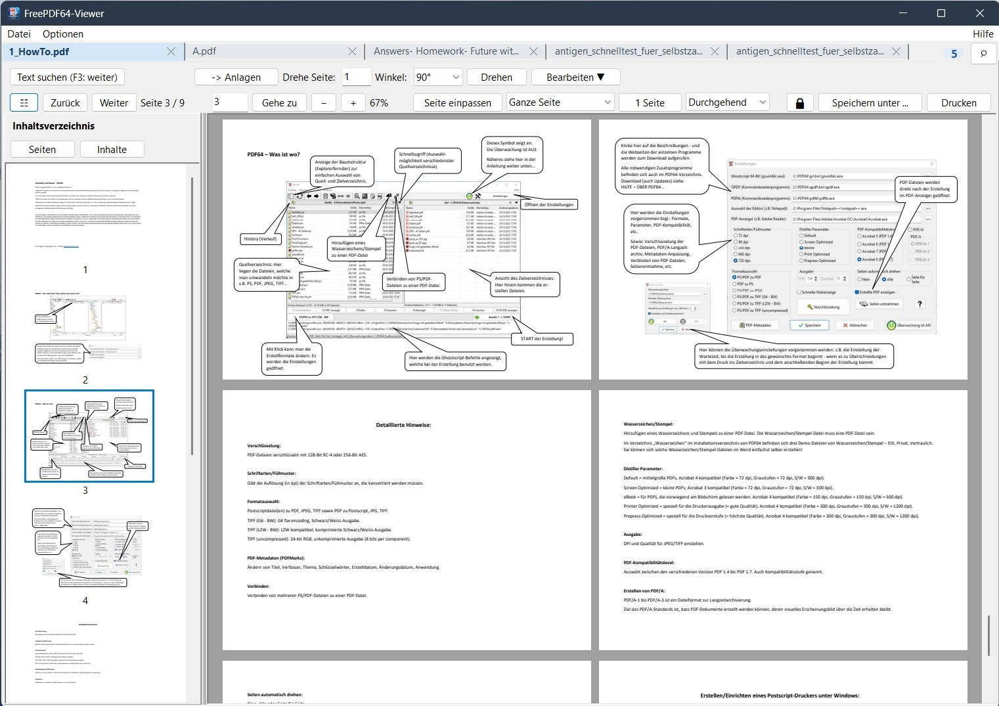

# FreePDF64-Viewer Portable

**Mehr als eine PDF-Anzeige: Alle geöffneten PDFs gemeinsam durchsuchen, Dokumentgruppen als Arbeitsbereiche speichern und große Dateien schnell öffnen.**

Ein kostenloser, eigenständig nutzbarer und portabler PDF-Viewer für Windows mit Registerkarten, dokumentübergreifender Suche und integrierten PDF-Werkzeugen.

[**Download / Releases**](https://github.com/FreePDF64/FreePDF64ViewerPortable/releases) · [**Projektseite**](https://github.com/FreePDF64/FreePDF64ViewerPortable) · [**Fragen und Anregungen**](mailto:FreePDF64@outlook.com?subject=Fragen%2FAnregungen%20zu%20FreePDF64ViewerPortable)

---

## Das macht den Viewer besonders

**Viele PDFs, eine Suche, ein Arbeitsbereich.** FreePDF64-Viewer Portable richtet sich an alle, die regelmäßig mit mehreren PDF-Dokumenten arbeiten und mehr benötigen als das bloße Anzeigen einzelner Dateien im Browser.

- 🔎 **Alle geöffneten PDFs gleichzeitig durchsuchen:** Die globale Volltextsuche durchsucht die Dokumente aller geöffneten Registerkarten. Treffer werden dokumentübergreifend aufgelistet; per Doppelklick springst du direkt zur Fundstelle – auch wenn das betreffende PDF zuvor noch nicht angezeigt wurde. Aufruf über **„Alle PDFs durchsuchen“** oder **Strg+Umschalt+F**.
- 🗂️ **Arbeitsbereiche speichern und wieder öffnen:** Stelle häufig benötigte PDF-Gruppen zusammen, speichere sie unter einem eigenen Namen und rufe sie später wieder auf. Mehrere Arbeitsbereiche lassen sich verwalten, umbenennen und löschen. So wird aus einer einmaligen PDF-Sitzung ein wiederverwendbarer Dokumentenbestand.
- ⚡ **Schneller Start und reaktionsfähige Oberfläche:** PDFs werden verzögert beziehungsweise asynchron geladen, damit das Hauptfenster rasch benutzbar ist. Auch die Suche nach eingebetteten PDF-Anlagen wurde auf eine asynchrone Verarbeitung umgestellt. Besonders bei umfangreichen Dokumenten ist das hilfreich.
- 📑 **Mehrere Dokumente in einer einzigen Anwendung:** Registerkarten, Seitenvorschau und Inhaltsverzeichnis erleichtern den Überblick. Der Viewer kann weitere PDFs an die bereits laufende Instanz übergeben, statt für jede Datei ein eigenes Fenster zu öffnen.
- 🛠️ **PDF-Werkzeuge direkt integriert:** Seiten drehen, verschieben, löschen oder extrahieren, Anlagen verwalten sowie einfache Markierungen hinzufügen – ohne für jede Aufgabe zu einer anderen Ansicht wechseln zu müssen.

**Der Unterschied zur typischen Browser-PDF-Anzeige:** Hier stehen nicht nur einzelne geöffnete Dokumente im Mittelpunkt, sondern die **dokumentübergreifende Suche** und **dauerhaft organisierbare PDF-Arbeitsbereiche**. Welche Funktionen ein Browser oder anderer Reader bietet, hängt von dessen Version und Erweiterungen ab.

## So sieht FreePDF64-Viewer Portable aus

*Der Viewer mit Registerkarten, Seitenvorschau, Dokumentanzeige und PDF-Werkzeugen.*

## Weitere Funktionen im Überblick

- **Mehrere PDFs in einem Fenster:** Jedes Dokument erhält eine eigene Registerkarte. Auch mehrere PDF-Dateien aus dem Windows-Datei-Explorer können im bereits laufenden Viewer geöffnet werden.
- **Nur eine Programminstanz:** Ein erneuter Start aktiviert den vorhandenen Viewer, statt ein zweites Fenster zu öffnen.
- **Registerkarten bequem verwalten:** Tabs über das kleine **×** oder mit **Strg+W** schließen; offene Tabs über die **Lupe** oder **Strg+Umschalt+A** suchen. Die Suche lässt sich mit derselben Tastenkombination oder **Esc** wieder schließen.
- **Flexible PDF-Anzeige:** Seitenvorschau, Inhaltsverzeichnis, Zoom, Seitennavigation sowie verschiedene Seiten- und Ansichtsmodi.
- **PDF-Werkzeuge:** Unter anderem Seiten drehen, nach oben/unten verschieben, löschen, extrahieren, Dokumenteigenschaften anzeigen und PDF-Anlagen verwalten.
- **PDF bearbeiten:** Freihandzeichnungen, Linien, Rechtecke und Ellipsen als Markierungen hinzufügen.
- **Optische Schwärzung:** Textbereiche mit schwarzen Rechtecken überdecken (keine sichere Entfernung des Textes).
- **PDF neu laden:** Das aktuelle Dokument über **Datei → PDF neu laden (Änderungen verwerfen)** erneut öffnen; vor dem Verwerfen ungespeicherter Änderungen wird nachgefragt.
- **Sitzung wiederherstellen:** Zuletzt geschlossene PDF-Dateien oder die letzte Sitzung über das Kontextmenü der leeren Startseite erneut öffnen.
- **Windows-Integration:** PDF-Dateien optional mit dem Viewer verknüpfen und direkt per Doppelklick öffnen.
- **Infobereich:** Den Viewer auf Wunsch beim Schließen in den Windows-Infobereich verschieben.

## Verbesserungen bei Anzeige und Bearbeitung

- **Asynchrones Laden:** PDF-Dateien können verzögert geladen werden, sodass das Viewer-Fenster zügig erscheint und bedienbar bleibt.
- **Asynchrone Anlagenerkennung:** Eingebettete PDF-Anlagen werden mit QPDF geprüft, ohne den Start durch eine lange synchrone Prüfung zu blockieren.
- **Schnelle erste Seitenanzeige:** Die erste sichtbare PDF-Seite wird beim Aufbau bevorzugt behandelt.
- **Rendercache:** Bereits berechnete Seitenbilder können wiederverwendet werden, um unnötiges Neurendern zu reduzieren.
- **Bedarfsgesteuerte Miniaturansichten:** Seitenvorschauen werden nach Bedarf aufgebaut.
- **Direkte Seitendrehung:** Drehungen erfolgen über PDFium im Speicher, ohne dafür zunächst eine temporäre PDF-Datei anzulegen; betroffene Anzeige- und Größencaches werden aktualisiert.

Diese Maßnahmen verbessern insbesondere Start und Bedienbarkeit. Sie bedeuten nicht, dass das Rendern selbst vollständig im Hintergrund stattfindet: Das Rendering erfolgt weiterhin im VCL-Hauptthread; ein eigenständiger Hintergrund-Render-Worker ist nicht Bestandteil dieser Version. Konkrete Geschwindigkeitsgewinne hängen vom PDF-Dokument und vom verwendeten System ab.

> **Wichtig zur optischen Schwärzung:** Ein schwarzes Rechteck verdeckt den darunterliegenden PDF-Text lediglich optisch. Der Text wird **nicht entfernt** und kann weiterhin ausgelesen, kopiert oder wiederhergestellt werden. Die Funktion eignet sich **nicht** zum sicheren Entfernen vertraulicher Informationen.

## Schnellstart

1. Die Dateien des Viewers gemeinsam in einen Ordner entpacken. Benötigte Bibliotheken und Zusatzprogramme müssen dabei erhalten bleiben.
2. **`FreePDF64ViewerPortable.exe`** starten.
3. Über **Datei → PDF öffnen …**, **Strg+O** oder **Drag & Drop** eine oder mehrere PDF-Dateien öffnen.
4. Optional unter **Optionen** die PDF-Dateiverknüpfung für Windows einrichten.

> **Hinweis zur Dateiverknüpfung:** Die Registrierung erfolgt für den aktuellen Windows-Benutzer. Unter Windows 10/11 muss der Viewer gegebenenfalls zusätzlich als Standard-App für `.pdf` ausgewählt werden.

## Bedienung auf einen Blick

| Funktion | Bedienung |
| --- | --- |
| PDF-Datei öffnen | **Strg+O** oder **Datei → PDF öffnen …** |
| Aktiven PDF-Tab schließen | **Strg+W** oder **×** am Tab |
| Geöffnete Tabs suchen / Suche schließen | **Strg+Umschalt+A**, **Lupe** oder **Esc** zum Schließen |
| Globale Volltextsuche über alle geöffneten PDFs | **Strg+Umschalt+F**, **Alle PDFs durchsuchen** oder **Bearbeiten** |
| Lokale Textsuche im aktuellen PDF | **Text suchen**, **F3** für die weitere Suche |
| Gespeicherte PDF-Arbeitsbereiche verwalten | Menü **Arbeitsbereiche** oder Startseite |
| PDF neu laden | **Datei → PDF neu laden (Änderungen verwerfen)** |
| Markierungen / optische Schwärzung | **Bearbeiten** → Werkzeug auswählen |
| Viewer beenden | **Datei → Exit** oder **Alt+F4** |
| Hilfe und Programminformationen | Menü **Hilfe** |
| Letzte Sitzung wiederherstellen | Rechtsklick auf die leere Startseite |

Beim Beenden gibt es keine zusätzliche allgemeine Bestätigungsfrage. **Bei ungespeicherten PDF-Änderungen kann weiterhin eine Speicherabfrage erscheinen.**

## Portabler Betrieb

FreePDF64-Viewer Portable ist als eigenständiger Windows-PDF-Viewer ausgelegt. Die Einstellungen werden in **`FreePDFViewer.ini`** im Programmordner gespeichert. Das optionale Startbild **`FreePDF64Viewer_Startbild.jpg`** gehört ebenfalls in diesen Ordner. Bei bestimmten Vorgängen kann **`FreePDF64ViewerLog.txt`** angelegt werden.

Wird die EXE nach einer PDF-Dateiverknüpfung verschoben, muss die Zuordnung unter Umständen erneut eingerichtet werden.

## Verwendete Komponenten und Lizenzen

Der Viewer nutzt **PDFium** (BSD-3-Clause License, Copyright © The PDFium Authors) sowie für bestimmte Funktionen **QPDF** und **Xpdf**. Für diese Komponenten gelten die jeweiligen Lizenz- und Copyrightbedingungen. Beachte bei der Weitergabe die zugehörigen Lizenztexte.

## Kontakt

Fragen, Fehlerberichte, Ideen oder Anregungen?

- **E-Mail:** [FreePDF64@outlook.com](mailto:FreePDF64@outlook.com?subject=Fragen%2FAnregungen%20zu%20FreePDF64ViewerPortable)
- **GitHub:** [FreePDF64ViewerPortable](https://github.com/FreePDF64/FreePDF64ViewerPortable)

---

**FreePDF64-Viewer Portable – PDF-Dateien komfortabel anzeigen und verwalten.**

Copyright © 2026 FreePDF64

