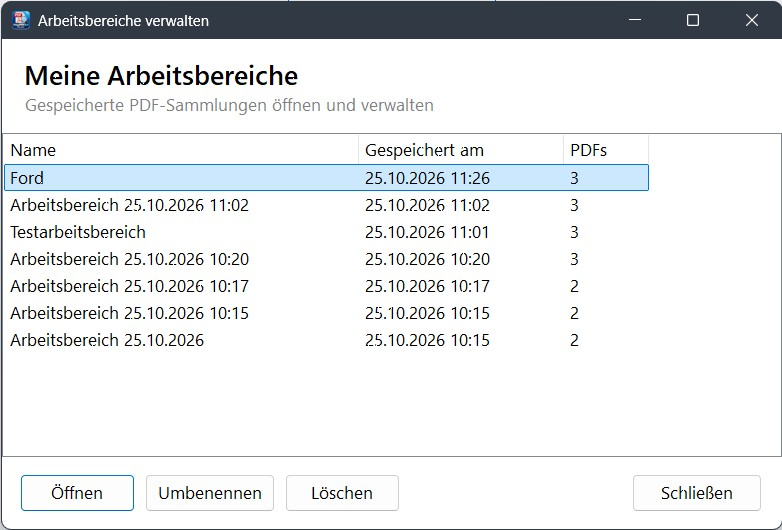
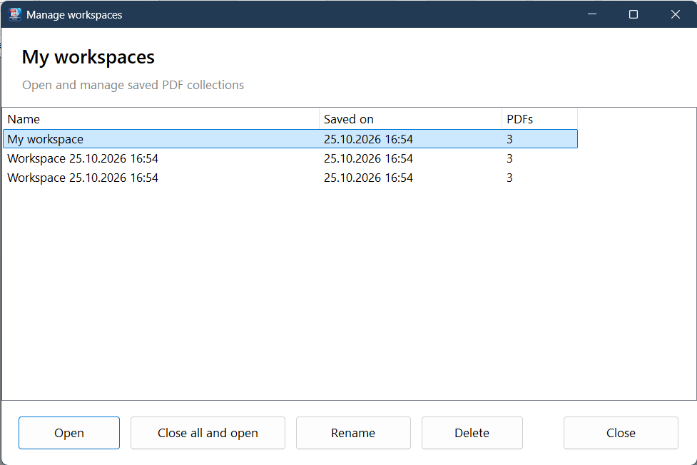
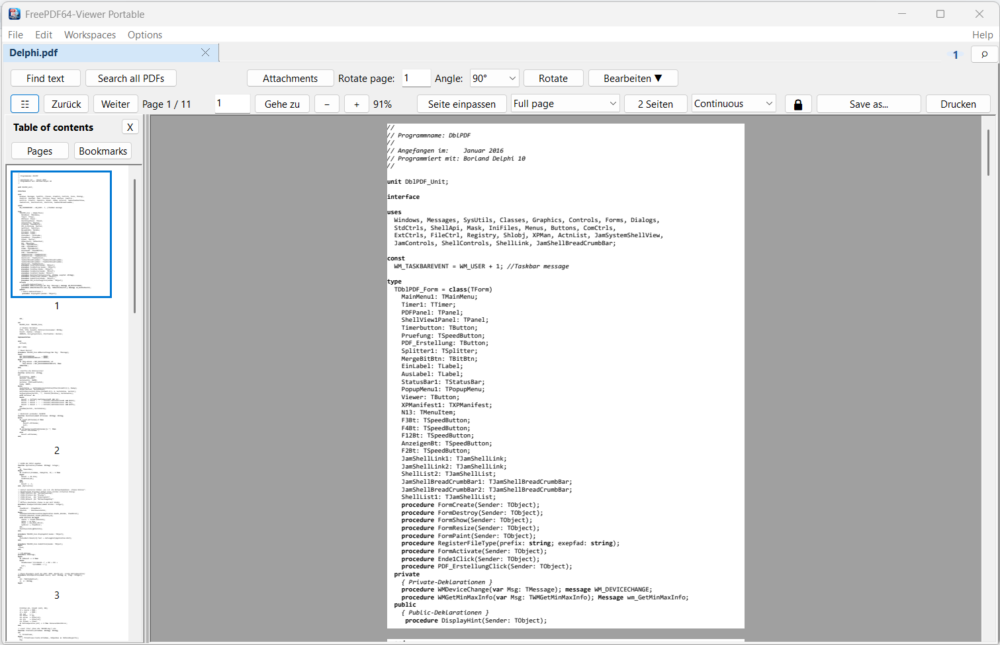

# FreePDF64-Viewer Portable

[Deutsch](#deutsch) · [English](#english)

---

# Deutsch

**Mehr als eine PDF-Anzeige: Alle geöffneten PDFs gemeinsam durchsuchen, Dokumentgruppen als Arbeitsbereiche speichern, Formulare bearbeiten und große Dateien schnell öffnen.**

Ein kostenloser, eigenständig nutzbarer und portabler PDF-Viewer für Windows mit Registerkarten, dokumentübergreifender Suche und integrierten PDF-Werkzeugen.

[**Download / Releases**](https://github.com/FreePDF64/FreePDF64ViewerPortable/releases) · [**Projektseite**](https://github.com/FreePDF64/FreePDF64ViewerPortable) · [**Fragen und Anregungen**](mailto:FreePDF64@outlook.com?subject=Fragen%2FAnregungen%20zu%20FreePDF64ViewerPortable)

## Das macht den Viewer besonders

**Viele PDFs, eine Suche, ein Arbeitsbereich.** FreePDF64-Viewer Portable richtet sich an alle, die regelmäßig mit mehreren PDF-Dokumenten arbeiten und mehr benötigen als das bloße Anzeigen einzelner Dateien im Browser.

- 🔎 **Alle geöffneten PDFs gleichzeitig durchsuchen:** Die globale Volltextsuche durchsucht die Dokumente aller geöffneten Registerkarten. Treffer werden dokumentübergreifend aufgelistet; per Doppelklick springst du direkt zur Fundstelle – auch wenn das betreffende PDF zuvor noch nicht angezeigt wurde. Aufruf über **„Alle PDFs durchsuchen“** oder **Strg+Umschalt+F**.
- 🗂️ **Arbeitsbereiche speichern und wieder öffnen:** Stelle häufig benötigte PDF-Gruppen zusammen, speichere sie unter einem eigenen Namen und rufe sie später wieder auf. Mehrere Arbeitsbereiche lassen sich verwalten, umbenennen und löschen. So wird aus einer einmaligen PDF-Sitzung ein wiederverwendbarer Dokumentenbestand.
- ⚡ **Schneller Start und reaktionsfähige Oberfläche:** PDFs werden verzögert beziehungsweise asynchron geladen, damit das Hauptfenster rasch benutzbar ist. Auch die Suche nach eingebetteten PDF-Anlagen wurde auf eine asynchrone Verarbeitung umgestellt. Besonders bei umfangreichen Dokumenten ist das hilfreich.
- 📑 **Mehrere Dokumente in einer einzigen Anwendung:** Registerkarten, Seitenvorschau und Inhaltsverzeichnis erleichtern den Überblick. Der Viewer kann weitere PDFs an die bereits laufende Instanz übergeben, statt für jede Datei ein eigenes Fenster zu öffnen.
- 🖼️ **Flexible Miniaturansichten:** Seitenvorschauen lassen sich vergrößern, um Details leichter zu erkennen. Seiten können mit gedrückter linker Maustaste neu angeordnet werden. Über das Kontextmenü lassen sich ausgewählte Seiten außerdem löschen, drehen oder extrahieren.
- 🛠️ **PDF-Werkzeuge direkt integriert:** Seiten drehen, verschieben, löschen oder extrahieren, Anlagen verwalten sowie einfache Markierungen hinzufügen – ohne für jede Aufgabe zu einer anderen Ansicht wechseln zu müssen.

**Der Unterschied zur typischen Browser-PDF-Anzeige:** Hier stehen nicht nur einzelne geöffnete Dokumente im Mittelpunkt, sondern die **dokumentübergreifende Suche** und **dauerhaft organisierbare PDF-Arbeitsbereiche**. Welche Funktionen ein Browser oder anderer Reader bietet, hängt von dessen Version und Erweiterungen ab.

## Arbeitsbereiche komfortabel verwalten

*Gespeicherte Arbeitsbereiche auf einen Blick: nach Speicherdatum sortiert, mit PDF-Anzahl und den Aktionen Öffnen, Umbenennen und Löschen.*

## So sieht FreePDF64-Viewer Portable aus

*Der Viewer mit Registerkarten, Seitenvorschau, Dokumentanzeige und PDF-Werkzeugen.*

## Miniaturansichten: Seiten direkt verwalten

Die Miniaturansicht dient nicht nur zur Navigation, sondern bietet praktische Funktionen zur Seitenverwaltung:

- **Vorschauen vergrößern:** Miniaturansichten lassen sich für eine bessere Übersicht vergrößern.
- **Seiten per Drag & Drop verschieben:** Seiten mit gedrückter **linker Maustaste** innerhalb der Miniaturansicht an eine andere Position ziehen.
- **Ausgewählte Seite(n) löschen:** Markierte Seiten über das Kontextmenü entfernen.
- **Ausgewählte Seite(n) drehen:** Seiten um **90° im Uhrzeigersinn** oder **90° gegen den Uhrzeigersinn** drehen.
- **Seite(n) extrahieren:** Ausgewählte Seiten über **„Seite(n) extrahieren …“** extrahieren.
- **Pflichtfelder prüfen:** Die Prüfung über **„Pflichtfelder prüfen …“** oder **F7** aufrufen.
- **PDF neu laden:** Über **„PDF neu laden (Änderungen verwerfen)“** das Dokument erneut laden; ungespeicherte Änderungen werden nur nach Rückfrage verworfen.

Die Aktionen stehen über das **Kontextmenü der Miniaturansicht** zur Verfügung.

## Weitere Funktionen im Überblick

- **Mehrere PDFs in einem Fenster:** Jedes Dokument erhält eine eigene Registerkarte. Auch mehrere PDF-Dateien aus dem Windows-Datei-Explorer können im bereits laufenden Viewer geöffnet werden.
- **Nur eine Programminstanz:** Ein erneuter Start aktiviert den vorhandenen Viewer, statt ein zweites Fenster zu öffnen.
- **Registerkarten bequem verwalten:** Tabs über das kleine **×** oder mit **Strg+W** schließen; offene Tabs über die **Lupe** oder **Strg+Umschalt+A** suchen. Die Suche lässt sich mit derselben Tastenkombination oder **Esc** wieder schließen.
- **Flexible PDF-Anzeige:** Vergrößerbare Seitenminiaturen, Inhaltsverzeichnis, Zoom, Seitennavigation sowie verschiedene Seiten- und Ansichtsmodi. Seiten lassen sich in der Miniaturansicht mit gedrückter linker Maustaste verschieben.
- **PDF-Werkzeuge:** Unter anderem Seiten drehen, nach oben/unten verschieben, löschen, extrahieren, Dokumenteigenschaften anzeigen und PDF-Anlagen verwalten.
- **PDF bearbeiten:** Freihandzeichnungen, Linien, Rechtecke und Ellipsen als Markierungen hinzufügen.
- **Optische Schwärzung:** Textbereiche mit schwarzen Rechtecken überdecken (keine sichere Entfernung des Textes).
- **PDF neu laden:** Das aktuelle Dokument über **Datei → PDF neu laden (Änderungen verwerfen)** erneut öffnen; vor dem Verwerfen ungespeicherter Änderungen wird nachgefragt.
- **Sitzung wiederherstellen:** Zuletzt geschlossene PDF-Dateien oder die letzte Sitzung über das Kontextmenü der leeren Startseite erneut öffnen.
- **Windows-Integration:** PDF-Dateien optional mit dem Viewer verknüpfen und direkt per Doppelklick öffnen.
- **Infobereich:** Den Viewer auf Wunsch beim Schließen in den Windows-Infobereich verschieben.

## Verbesserungen bei Anzeige und Bearbeitung

- **Asynchrones Laden:** PDF-Dateien können verzögert geladen werden, sodass das Viewer-Fenster zügig erscheint und bedienbar bleibt.
- **Asynchrone Anlagenerkennung:** Eingebettete PDF-Anlagen werden mit QPDF geprüft, ohne den Start durch eine lange synchrone Prüfung zu blockieren.
- **Schnelle erste Seitenanzeige:** Die erste sichtbare PDF-Seite wird beim Aufbau bevorzugt behandelt.
- **Rendercache:** Bereits berechnete Seitenbilder können wiederverwendet werden, um unnötiges Neurendern zu reduzieren.
- **Bedarfsgesteuerte Miniaturansichten:** Seitenvorschauen werden nach Bedarf aufgebaut. Die Miniaturen lassen sich vergrößern; Seiten können per Ziehen mit gedrückter linker Maustaste direkt in der Vorschau verschoben werden.
- **Direkte Seitendrehung:** Drehungen erfolgen über PDFium im Speicher, ohne dafür zunächst eine temporäre PDF-Datei anzulegen; betroffene Anzeige- und Größencaches werden aktualisiert.

Diese Maßnahmen verbessern insbesondere Start und Bedienbarkeit. Sie bedeuten nicht, dass das Rendern selbst vollständig im Hintergrund stattfindet: Das Rendering erfolgt weiterhin im VCL-Hauptthread; ein eigenständiger Hintergrund-Render-Worker ist nicht Bestandteil dieser Version. Konkrete Geschwindigkeitsgewinne hängen vom PDF-Dokument und vom verwendeten System ab.

> **Wichtig zur optischen Schwärzung:** Ein schwarzes Rechteck verdeckt den darunterliegenden PDF-Text lediglich optisch. Der Text wird **nicht entfernt** und kann weiterhin ausgelesen, kopiert oder wiederhergestellt werden. Die Funktion eignet sich **nicht** zum sicheren Entfernen vertraulicher Informationen.

## Schnellstart

1. Die Dateien des Viewers gemeinsam in einen Ordner entpacken. Benötigte Bibliotheken und Zusatzprogramme müssen dabei erhalten bleiben.
2. **`FreePDF64ViewerPortable.exe`** starten.
3. Über **Datei → PDF öffnen …**, **Strg+O** oder **Drag & Drop** eine oder mehrere PDF-Dateien öffnen.
4. Optional unter **Optionen** die PDF-Dateiverknüpfung für Windows einrichten.

> **Hinweis zur Dateiverknüpfung:** Die Registrierung erfolgt für den aktuellen Windows-Benutzer. Unter Windows 10/11 muss der Viewer gegebenenfalls zusätzlich als Standard-App für `.pdf` ausgewählt werden.

## Bedienung auf einen Blick

| Funktion | Bedienung |
| --- | --- |
| PDF-Datei öffnen | **Strg+O** oder **Datei → PDF öffnen …** |
| Aktiven PDF-Tab schließen | **Strg+W** oder **×** am Tab |
| Geöffnete Tabs suchen / Suche schließen | **Strg+Umschalt+A**, **Lupe** oder **Esc** zum Schließen |
| Globale Volltextsuche über alle geöffneten PDFs | **Strg+Umschalt+F**, **Alle PDFs durchsuchen** oder **Bearbeiten** |
| Lokale Textsuche im aktuellen PDF | **Text suchen**, **F3** für die weitere Suche |
| Gespeicherte PDF-Arbeitsbereiche verwalten | Menü **Arbeitsbereiche** oder Startseite |
| PDF neu laden | **Datei → PDF neu laden (Änderungen verwerfen)** |
| Markierungen / optische Schwärzung | **Bearbeiten** → Werkzeug auswählen |
| Viewer beenden | **Datei → Exit** oder **Alt+F4** |
| Hilfe und Programminformationen | Menü **Hilfe** |
| Letzte Sitzung wiederherstellen | Rechtsklick auf die leere Startseite |

Beim Beenden gibt es keine zusätzliche allgemeine Bestätigungsfrage. **Bei ungespeicherten PDF-Änderungen kann weiterhin eine Speicherabfrage erscheinen.**

## Portabler Betrieb

FreePDF64-Viewer Portable ist als eigenständiger Windows-PDF-Viewer ausgelegt. Die Einstellungen werden in **`FreePDFViewer.ini`** im Programmordner gespeichert. Das optionale Startbild **`FreePDF64Viewer_Startbild.jpg`** gehört ebenfalls in diesen Ordner. Bei bestimmten Vorgängen kann **`FreePDF64ViewerLog.txt`** angelegt werden.

Wird die EXE nach einer PDF-Dateiverknüpfung verschoben, muss die Zuordnung unter Umständen erneut eingerichtet werden.

## Verwendete Komponenten und Lizenzen

Der Viewer nutzt **PDFium** (BSD-3-Clause License, Copyright © The PDFium Authors) sowie für bestimmte Funktionen **QPDF** und **Xpdf**. Für diese Komponenten gelten die jeweiligen Lizenz- und Copyrightbedingungen. Beachte bei der Weitergabe die zugehörigen Lizenztexte.

## Kontakt

Fragen, Fehlerberichte, Ideen oder Anregungen?

- **E-Mail:** [FreePDF64@outlook.com](mailto:FreePDF64@outlook.com?subject=Fragen%2FAnregungen%20zu%20FreePDF64ViewerPortable)
- **GitHub:** [FreePDF64ViewerPortable](https://github.com/FreePDF64/FreePDF64ViewerPortable)

**FreePDF64-Viewer Portable – PDF-Dateien komfortabel anzeigen und verwalten.**

Copyright © 2026 FreePDF64

---

# English

**More than a PDF viewer: Search all open PDFs at once, save document groups as workspaces, and open large files quickly.**

A free, standalone, portable PDF viewer for Windows with tabs, cross-document search, edit forms and integrated PDF tools.

[**Download / Releases**](https://github.com/FreePDF64/FreePDF64ViewerPortable/releases) · [**Project page**](https://github.com/FreePDF64/FreePDF64ViewerPortable) · [**Questions and feedback**](mailto:FreePDF64@outlook.com?subject=Questions%2FFeedback%20about%20FreePDF64ViewerPortable)

## What makes this viewer special

**Many PDFs, one search, one workspace.** FreePDF64-Viewer Portable is designed for people who regularly work with multiple PDF documents and need more than simply viewing individual files in a browser.

- 🔎 **Search all open PDFs at once:** The global full-text search scans the documents in all open tabs. Results are listed across documents; double-click a result to jump directly to the matching location—even if that PDF has not previously been displayed. Open it via **Search all PDFs** or **Ctrl+Shift+F**.
- 🗂️ **Save and reopen workspaces:** Group frequently used PDFs, save the group under a custom name, and reopen it later. You can manage, rename, and delete multiple workspaces. Turn a one-time PDF session into a reusable collection of documents.
- ⚡ **Fast startup and a responsive interface:** PDFs are loaded on demand or asynchronously so the main window becomes usable quickly. Searching embedded PDF attachments has also been moved to asynchronous processing. This is especially useful with large documents.
- 📑 **Multiple documents in one application:** Tabs, page thumbnails, and the table of contents make it easier to navigate. The viewer can send additional PDFs to an already running instance instead of opening a separate window for each file.
- 🖼️ **Resizable page thumbnails:** Enlarge page thumbnails for a closer look and move pages directly in the thumbnail pane by dragging them with the left mouse button held down. A context menu also provides actions to delete, rotate, or extract selected pages.
- 🛠️ **Built-in PDF tools:** Rotate, move, delete, or extract pages, manage attachments, and add simple annotations without having to switch to a different view for every task.

**How it differs from a typical browser PDF viewer:** The focus is not just on individual open documents, but on **cross-document search** and **reusable PDF workspaces**. The features available in a browser or another reader depend on its version and extensions.

## Manage workspaces with ease

*Saved workspaces at a glance: sorted by save date, with the PDF count and options to open, rename, or delete each workspace.*

## See FreePDF64-Viewer Portable in action

*The viewer with tabs, page thumbnails, document display, and PDF tools.*

## Page thumbnails: Manage pages directly

The thumbnail pane is more than a navigation aid: it also provides convenient page-management tools.

- **Enlarge thumbnails:** Increase thumbnail size for a clearer view.
- **Reorder pages with drag and drop:** Hold down the **left mouse button** and drag a page to a different position in the thumbnail pane.
- **Delete selected page(s):** Remove selected pages from the context menu.
- **Rotate selected page(s):** Rotate pages **90° clockwise** or **90° counterclockwise**.
- **Extract page(s):** Use **Extract Page(s)…** for selected pages.
- **Check required fields:** Run **Check Required Fields…** or press **F7**.
- **Reload PDF:** Use **Reload PDF (Discard Changes)** to reopen the document; the viewer asks before discarding unsaved changes.

These actions are available from the **thumbnail pane's context menu**.

## More features at a glance

- **Multiple PDFs in one window:** Each document gets its own tab. Multiple PDF files selected in Windows File Explorer can also be opened in the viewer that is already running.
- **Single application instance:** Starting the program again activates the existing viewer instead of opening a second window.
- **Easy tab management:** Close tabs using the small **×** or **Ctrl+W**; find open tabs using the **magnifying glass** or **Ctrl+Shift+A**. Close the search with the same shortcut or **Esc**.
- **Flexible PDF viewing:** Resizable page thumbnails, table of contents, zoom, page navigation, and various page and viewing modes. Move pages directly in the thumbnail pane by dragging them with the left mouse button held down.
- **PDF tools:** Rotate, move pages up or down, delete or extract pages, view document properties, and manage PDF attachments.
- **Annotate PDFs:** Add freehand drawings, lines, rectangles, and ellipses as annotations.
- **Visual redaction:** Cover text areas with black rectangles (this does not securely remove the underlying text).
- **Reload a PDF:** Reopen the current document using **File → Reload PDF (Discard Changes)**; the viewer asks before discarding unsaved changes.
- **Restore a session:** Reopen recently closed PDFs or the last session using the context menu on the empty start page.
- **Windows integration:** Optionally associate PDF files with the viewer and open them directly by double-clicking.
- **System tray:** Optionally minimize the viewer to the Windows notification area when closing it.

## Viewing and editing improvements

- **Asynchronous loading:** PDF files can be loaded on demand so the viewer window appears quickly and remains responsive.
- **Asynchronous attachment detection:** Embedded PDF attachments are checked using QPDF without blocking startup with a long synchronous check.
- **Faster first-page display:** The first visible PDF page is prioritized during initialization.
- **Rendering cache:** Previously rendered page images can be reused to reduce unnecessary rendering.
- **On-demand thumbnails:** Page thumbnails are generated as needed. Thumbnails can be enlarged, and pages can be moved directly in the thumbnail pane by dragging them with the left mouse button held down.
- **Direct page rotation:** Rotation is performed in memory through PDFium without first creating a temporary PDF file; affected display and size caches are updated.

These measures primarily improve startup time and usability. They do not mean that rendering itself takes place entirely in the background: rendering still runs in the VCL main thread, and this version does not include a dedicated background rendering worker. Actual speed improvements depend on the PDF document and the system being used.

> **Important note about visual redaction:** A black rectangle only visually covers the PDF text underneath it. The text is **not removed** and may still be extracted, copied, or recovered. This feature is **not suitable** for securely removing confidential information.

## Quick start

1. Extract all viewer files together into one folder. Keep any required libraries and auxiliary programs alongside them.
2. Run **`FreePDF64ViewerPortable.exe`**.
3. Open one or more PDF files via **File → Open PDF…**, **Ctrl+O**, or **drag and drop**.
4. Optionally, configure the PDF file association for Windows under **Options**.

> **Note about file associations:** Registration applies to the current Windows user. On Windows 10/11, you may also need to select the viewer as the default app for `.pdf` files.

## Quick reference

| Function | How to use it |
| --- | --- |
| Open a PDF file | **Ctrl+O** or **File → Open PDF…** |
| Close the active PDF tab | **Ctrl+W** or the tab’s **×** |
| Find open tabs / close search | **Ctrl+Shift+A**, the **magnifying glass**, or **Esc** to close |
| Full-text search across all open PDFs | **Ctrl+Shift+F**, **Search all PDFs**, or **Edit** |
| Search text in the current PDF | **Find text**; press **F3** to find the next occurrence |
| Manage saved PDF workspaces | **Workspaces** menu or start page |
| Reload a PDF | **File → Reload PDF (Discard Changes)** |
| Annotations / visual redaction | **Edit** → select a tool |
| Exit the viewer | **File → Exit** or **Alt+F4** |
| Help and program information | **Help** menu |
| Restore the last session | Right-click the empty start page |

There is no additional general confirmation prompt when exiting. **A save prompt may still appear if there are unsaved PDF changes.**

## Portable operation

FreePDF64-Viewer Portable is designed as a standalone PDF viewer for Windows. Settings are stored in **`FreePDFViewer.ini`** in the program folder. The optional startup image **`FreePDF64Viewer_Startbild.jpg`** should also be placed in this folder. Depending on the operation, **`FreePDF64ViewerLog.txt`** may be created.

If the EXE is moved after a PDF file association has been configured, the association may need to be set up again.

## Components and licenses

The viewer uses **PDFium** (BSD-3-Clause License, Copyright © The PDFium Authors), as well as **QPDF** and **Xpdf** for certain functions. These components are subject to their respective license and copyright terms. Please observe the associated license texts when redistributing the software.

## Contact

Questions, bug reports, ideas, or feedback?

- **Email:** [FreePDF64@outlook.com](mailto:FreePDF64@outlook.com?subject=Questions%2FFeedback%20about%20FreePDF64ViewerPortable)
- **GitHub:** [FreePDF64ViewerPortable](https://github.com/FreePDF64/FreePDF64ViewerPortable)

**FreePDF64-Viewer Portable – View and manage PDF files with ease.**

Copyright © 2026 FreePDF64

