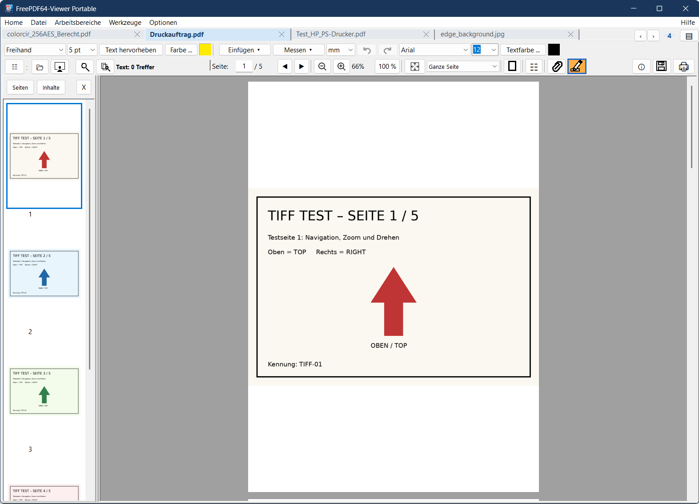

# FreePDF64-Viewer Portable 3.3.0

**Free, open-source PDF and image viewer for Windows – portable, fast and versatile.**

[English](#english) · [Deutsch](#deutsch)

[**Download / Releases**](https://github.com/FreePDF64/FreePDF64ViewerPortable/releases) · [**Projektseite**](https://github.com/FreePDF64/FreePDF64ViewerPortable)

---

# English

FreePDF64-Viewer Portable is a free, open-source PDF viewer for Windows. It combines a fast PDF and image viewer with tabs, **named, reusable workspaces**, cross-document search, side-by-side viewing, and practical PDF tools. Save a collection of open documents and return to it later instead of reopening every file individually. Settings are stored locally in the application folder.

## New in version 3.3.0

- **Redesigned VCL Ribbon:** Replaced the Windows Ribbon Framework with a custom VCL Ribbon. Clearly organized tabs, including **Objects**, provide direct access to viewing, editing, image, and PDF tools. Monochrome Tabler icons are embedded in the executable; no external icon folder is required.
- **Editable PDF zoom percentage:** View the current zoom level in the **View** ribbon, enter a value such as `150 %`, and press Enter to apply it. The display follows zoom changes and switching between open PDFs.
- **Clearer PDF saving:** **Save** (Ctrl+S) writes changes directly to the open PDF; **Save PDF As…** opens a separate dialog. An orange highlight indicates unsaved changes, with a warning when closing modified documents.
- **Redaction controls:** Improved Ribbon access to optical redaction and permanent redaction, including an orange active-tool outline. **Optical redaction only hides content; use permanent redaction to remove it.**
- **Image and multipage TIFF tools:** Reorganized Ribbon commands for image zoom, fit, original size, rotation, saving, and printing, with navigation between pages of multipage TIFFs.
- **Improved editing feedback:** Newly placed PDF hyperlinks can show their target URL as a tooltip before the PDF is saved. Refined Ribbon hover states, button spacing, and tool selection.
- **German/English and high-DPI layouts:** Updated bilingual labels, tooltips, and feature help; refined Ribbon presentation for 4K and WQHD displays.

### Also introduced in version 3.2.4

- **Insert images into PDF pages:** Add PNG, JPEG, BMP, and TIFF images from the Insert menu, the PDF page context menu, or the thumbnail context menu. Place and resize images visually on the PDF page, reposition them with Ctrl+drag, and confirm with Enter or cancel with Esc.
- **Multipage TIFF support:** Select a page from a visual gallery of TIFF thumbnails before inserting it into the PDF.
- **Undo/Redo and saving:** Undo or redo inserted images and save them permanently in the PDF document.
- **Font overview:** Switch between document information and a separate font overview in Document Properties (Ctrl+D), with detected font names and a German/English interface.
- **Windows Classic – Flat Buttons:** New selectable theme variant combining the flat button appearance of Classic Blue with the original Windows Classic gray colors.
- **4K/WQHD and bilingual help:** DPI-aware document-property controls and TIFF selection, plus updated English and German feature documentation.

### Also introduced in version 3.2.3

- **Extract embedded PDF images:** Browse detected image objects with previews, select one or multiple images, and export original JPEG data where supported or save images as PNG, JPEG, or TIFF.
- **Export complete PDF pages:** Save whole pages as PNG, JPEG, or TIFF, including pages assembled from multiple image strips. Individual-image export still exports the separate embedded objects.
- **PDFium instead of QPDF:** Page management, embedded attachments, and PDF security information now use PDFium; the `qpdf` folder is no longer required by the viewer.
- **Refined image-export dialog:** German/English interface, 4K/WQHD layouts, ESC to close, and saved window size in `FreePDFViewer.ini`.

### Also introduced in version 3.2.2

- **Improved PDF hyperlinks:** Automatically add HTTPS to web addresses, show link destinations as tooltips, and reposition hyperlinks with Ctrl+drag.
- **Custom measurement colors:** Select a measurement color and see it in a compact toolbar color preview. Measurement borders retain consistent thickness when saved and reopened.
- **Refined toolbar and themes:** Clear orange active-tool indicators, compact color previews, and improved display across four interface themes.
- **PDF attachments and export:** Improved attachment handling and export of PDF pages as images or text, with refined German/English dialogs.
- **Simplified portable installation:** The `Xpdf` folder is no longer required by FreePDF64-Viewer Portable and may be deleted from existing viewer installations.

### Also introduced in version 3.2.1

- **Secure PDF redaction:** Preview redaction areas, inspect affected content, and permanently apply redactions to rasterized pages. Includes a redaction report and an automatic check of the resulting PDF.
- **Hand tool:** Dedicated toolbar button with an orange active-state highlight for moving zoomed PDF pages.

### Also introduced in version 3.2.0

- **Signatures:** Draw a signature or use a transparent PNG image; save, reopen, rename, delete, and place signatures on PDF pages. Adjust their position and size.
- **Improved dialogs:** Refined theme colors, buttons, and layout for 4K and WQHD displays, including comment editing and saved-signature management.
- **PDF measurements:** Measure rectangle width and height in mm/cm/in with a selectable drawing scale; copy or export measurement reports as CSV. Save measurements as PDF annotations.

## Key features

- **VCL Ribbon:** Organized commands with embedded monochrome icons and an editable PDF zoom-percentage field.

- **Tabs and workspaces:** Open multiple PDFs and images in tabs, save named workspaces, and restore collections of documents and their zoom settings.
- **Side-by-side comparison:** View two PDFs together; **S** synchronizes scrolling and **Z** synchronizes zoom (left → right).
- **Search:** Search one PDF or all open PDFs using **Ctrl+Shift+F**.
- **Page management:** Resizable thumbnails; drag and drop pages to reorder, rotate, delete, or extract them.
- **PDF editing:** Insert images, text, comments, drawings, highlights, watermarks, and clickable hyperlinks; Undo/Redo for supported edits.
- **PDF forms:** Edit AcroForm and supported static XFA forms; run supported V8 JavaScript actions and calculations.
- **Images:** Open, zoom, rotate, and save JPG/JPEG, PNG, BMP, and single- or multipage TIFF files; preview and extract embedded PDF images.
- **More:** View PDF font information, manage attachments, export PDF pages as images or text, use bookmarks, switch between German and English, and choose interface themes.

## Workspaces – pick up where you left off

**Workspaces are a standout feature of FreePDF64-Viewer Portable:** Instead of reopening documents one by one, save the currently open PDFs and supported images as a **named workspace** and reopen that collection whenever you need it. This is particularly useful for recurring projects, research, or working with several related documents.

- **Save and restore:** Keep multiple named workspaces and reopen their documents, including saved zoom levels.
- **Manage efficiently:** Search, sort, inspect workspace contents, rename, and delete saved workspaces in a dedicated management window.
- **Portable workflow:** Workspace management is integrated into the viewer, without a separate project-management application.

See the **Workspaces** screenshot below for the management interface.

## Screenshots

*Click a thumbnail to open the full-size image.*

## Quick start

1. Extract the entire release ZIP to a folder, keeping bundled libraries and auxiliary tools.
2. Run **`FreePDF64ViewerPortable.exe`**.
3. Open PDFs using **Ctrl+O**, drag and drop, or Windows File Explorer. Supported image files can also be opened.

**Upgrade note:** The `Xpdf` and `qpdf` folders from older viewer versions are no longer needed by FreePDF64-Viewer Portable and can be deleted from the viewer installation.

**Notes:** Measurements depend on the drawing scale and source PDF. **Visual redaction** only covers content; it does not securely remove it. Not every PDF JavaScript feature or XFA form is supported.

## Portable use and license

Settings are stored in **`FreePDFViewer.ini`** in the application folder.

**FreePDF64-Viewer Portable** is free and open-source software licensed under **GNU GPL v3 (GPL-3.0-only)**. Use, modification, and redistribution are subject to this license. See **`LIZENZ_DE.txt`** (German) and **`LICENSE_NOTICE_EN.txt`** (English).

**Third-party libraries and tools:**
- **[PDFium](https://pdfium.googlesource.com/pdfium/):** PDF rendering and processing, © The PDFium Authors.
- **[V8](https://v8.dev/):** JavaScript engine, © The V8 Project Authors.

License texts and copyright notices for PDFium, V8, and bundled third-party libraries are included in the **`PDFium`** subfolder (**`LICENSE`** file and **`licenses`** directory). Their respective license terms must be observed when redistributing the software. FreePDF64-Viewer Portable is **not an official product of PDFium, V8, or Google**.

**Contact:** [FreePDF64@outlook.com](mailto:FreePDF64@outlook.com) · [GitHub](https://github.com/FreePDF64/FreePDF64ViewerPortable)

---

# Deutsch

FreePDF64-Viewer Portable ist ein kostenloser Open-Source-PDF-Viewer für Windows. Er vereint einen schnellen PDF- und Bildbetrachter mit Registerkarten, **benannten und wiederverwendbaren Arbeitsbereichen**, dokumentübergreifender Suche, Zweifensteransicht und praktischen PDF-Werkzeugen. Zusammengehörige Dokumente lassen sich als Arbeitsbereich speichern und später bequem wieder öffnen. Die Einstellungen bleiben lokal im Programmordner.

## Neu in Version 3.3.0

- **Neu gestaltetes VCL-Ribbon:** Das Windows Ribbon Framework wurde durch ein eigenes VCL-Ribbon ersetzt. Übersichtlich angeordnete Registerkarten, darunter **„Objekte“**, bieten direkten Zugriff auf Anzeige-, Bearbeitungs-, Grafik- und PDF-Werkzeuge. Einfarbige Tabler-Symbole sind direkt in die EXE eingebettet; ein externer Symbolordner ist nicht erforderlich.
- **Editierbare PDF-Zoom-Prozentanzeige:** Den aktuellen Zoomfaktor im Ribbon unter **„Ansicht“** ablesen, einen Wert wie `150 %` eingeben und mit Enter übernehmen. Die Anzeige folgt Zoomänderungen und dem Wechsel zwischen geöffneten PDFs.
- **Übersichtlichere PDF-Speicherung:** **„Speichern“** (Strg+S) schreibt Änderungen direkt in die geöffnete PDF; **„PDF speichern unter …“** öffnet einen eigenen Dialog. Ein orangefarbener Rahmen kennzeichnet ungespeicherte Änderungen; beim Schließen geänderter Dokumente erscheint eine Warnung.
- **Schwärzungswerkzeuge:** Verbesserter Zugriff auf optische und endgültige Schwärzung im Ribbon, einschließlich orangefarbener Aktivmarkierung. **Die optische Schwärzung verdeckt Inhalte nur; zum Entfernen ist die endgültige Schwärzung erforderlich.**
- **Grafik- und mehrseitige TIFF-Werkzeuge:** Neu angeordnete Ribbon-Befehle für Grafikzoom, Einpassen, Originalgröße, Drehen, Speichern und Drucken sowie Navigation durch mehrseitige TIFF-Dateien.
- **Verbesserte Rückmeldungen bei der Bearbeitung:** Neu platzierte PDF-Hyperlinks können ihre Zieladresse bereits vor dem Speichern als Hinweis anzeigen. Überarbeitete Ribbon-Hover-Markierungen, Buttonabstände und Werkzeugauswahl.
- **Deutsch/Englisch und hohe DPI-Auflösungen:** Aktualisierte zweisprachige Beschriftungen, Hinweise und Funktionsübersicht; optimierte Ribbon-Darstellung für 4K und WQHD.

### Bereits in Version 3.2.4 eingeführt

- **Bilder in PDF-Seiten einfügen:** PNG-, JPEG-, BMP- und TIFF-Bilder über das Menü „Einfügen …“, das PDF-Seiten-Kontextmenü oder das Miniatur-Kontextmenü einfügen. Bilder direkt auf der PDF-Seite visuell platzieren und skalieren, mit Strg+Ziehen verschieben und mit Enter übernehmen oder mit Esc abbrechen.
- **Mehrseitige TIFF-Dateien:** Die gewünschte TIFF-Seite vor dem Einfügen komfortabel über eine visuelle Miniaturübersicht auswählen.
- **Rückgängig/Wiederholen und Speichern:** Eingefügte Bilder rückgängig machen, wiederherstellen und dauerhaft in der PDF speichern.
- **Schriftartenübersicht:** In den Dokumenteigenschaften (Strg+D) zwischen Dokumentinformationen und einer eigenen Schriftartenübersicht mit erkannten Schriftartnamen wechseln; Oberfläche auf Deutsch und Englisch.
- **Windows Klassik – Flache Buttons:** Neue auswählbare Designvariante mit der flachen Buttondarstellung von „Klassisch Blau“ und den originalen grauen Farben von „Windows Klassik“.
- **4K/WQHD und zweisprachige Hilfe:** DPI-angepasste Dokumenteigenschaften und TIFF-Seitenauswahl sowie aktualisierte Funktionsübersicht auf Deutsch und Englisch.

### Bereits in Version 3.2.3 eingeführt

- **Eingebettete PDF-Bilder extrahieren:** Erkannte Bildobjekte mit Vorschau anzeigen, einzelne oder mehrere Bilder auswählen und geeignete JPEG-Originaldaten direkt oder Bilder als PNG, JPEG und TIFF exportieren.
- **Vollständige PDF-Seiten exportieren:** Ganze Seiten als PNG, JPEG oder TIFF speichern, auch wenn das Motiv aus mehreren Bildstreifen besteht. Beim Export einzelner Bilder bleiben die eingebetteten Bildobjekte getrennt.
- **PDFium statt QPDF:** Seitenverwaltung, eingebettete PDF-Anlagen und Sicherheitsinformationen werden über PDFium verarbeitet. Das Verzeichnis `qpdf` wird vom Viewer nicht mehr benötigt.
- **Überarbeiteter Bildexport-Dialog:** Deutsche und englische Oberfläche, 4K-/WQHD-Darstellung, Schließen mit ESC und Speichern der Fenstergröße in der `FreePDFViewer.ini`.

### Bereits in Version 3.2.2 eingeführt

- **Verbesserte PDF-Hyperlinks:** Webadressen automatisch um HTTPS ergänzen, Zieladressen als Hinweis anzeigen und Hyperlinks mit Strg+Ziehen verschieben.
- **Individuelle Messfarben:** Messfarbe frei wählen und in einer kompakten Farbvorschau der Symbolleiste erkennen. Messrahmen behalten beim Speichern und erneuten Öffnen ihre einheitliche Linienstärke.
- **Optimierte Symbolleisten und Designs:** Orangefarbene Aktivmarkierung für Werkzeuge, kompakte Farbvorschauen und verbesserte Darstellung in allen vier Designs.
- **PDF-Anlagen und Export:** Verbesserte Anlagenverwaltung und Export von PDF-Seiten als Bilder oder Text sowie überarbeitete Dialoge auf Deutsch und Englisch.
- **Vereinfachte portable Installation:** Das Verzeichnis `Xpdf` wird von FreePDF64-Viewer Portable nicht mehr benötigt und kann aus bestehenden Viewer-Installationen gelöscht werden.

### Bereits in Version 3.2.1 eingeführt

- **Sichere PDF-Schwärzung:** Schwärzungsbereiche in der Vorschau markieren, betroffene Inhalte prüfen und Schwärzungen auf gerasterten Seiten dauerhaft anwenden. Mit Schwärzungsprüfbericht und automatischer Prüfung der erzeugten PDF.
- **Hand-Werkzeug:** Eigener Symbolleisten-Button mit orangefarbener Aktivmarkierung zum Verschieben vergrößerter PDF-Seiten.

### Bereits in Version 3.2.0 eingeführt

- **Unterschriften:** Unterschriften zeichnen oder als transparente PNG-Grafik verwenden, speichern, erneut aufrufen, umbenennen, löschen und auf PDF-Seiten platzieren. Position und Größe lassen sich anpassen.
- **Verbesserte Dialoge:** Überarbeitete Designfarben, Schaltflächen und Darstellung auf 4K- und WQHD-Bildschirmen, unter anderem beim Bearbeiten von Kommentaren und Verwalten gespeicherter Unterschriften.
- **PDF-Messwerkzeuge:** Rechtecke mit Breite und Höhe messen, mm/cm/Zoll und Zeichnungsmaßstab wählen; Messbericht kopieren oder als CSV exportieren. Messungen lassen sich als PDF-Anmerkungen speichern.

## Funktionen im Überblick

- **VCL-Ribbon:** Übersichtlich angeordnete Befehle mit eingebetteten einfarbigen Symbolen und editierbarer PDF-Zoom-Prozentanzeige.

- **Registerkarten und Arbeitsbereiche:** Mehrere PDFs und Bilder in Registerkarten öffnen, benannte Arbeitsbereiche speichern und Dokumente samt Zoom-Einstellungen wiederherstellen.
- **PDF-Vergleich:** Zwei PDFs nebeneinander anzeigen; **S** synchronisiert das Scrollen, **Z** den Zoom (jeweils links → rechts).
- **Suche:** Einzelne PDFs durchsuchen oder alle geöffneten PDFs gemeinsam mit **Strg+Umschalt+F**.
- **Seitenverwaltung:** Vergrößerbare Miniaturen; Seiten per Drag & Drop verschieben, drehen, löschen oder extrahieren.
- **PDF-Bearbeitung:** Bilder, Text, Kommentare, Zeichnungen, Markierungen, Wasserzeichen und anklickbare Hyperlinks hinzufügen; Rückgängig/Wiederholen für unterstützte Bearbeitungen.
- **PDF-Formulare:** AcroForm und unterstützte statische XFA-Formulare bearbeiten; unterstützte JavaScript-V8-Aktionen und Berechnungen ausführen.
- **Bilder:** JPG/JPEG, PNG, BMP sowie ein- und mehrseitige TIFF-Dateien öffnen, zoomen, drehen und speichern; eingebettete PDF-Bilder anzeigen und extrahieren.
- **Weitere Funktionen:** PDF-Schriftarten anzeigen, PDF-Anlagen verwalten, PDF-Seiten als Bilder oder Text exportieren, Inhaltsverzeichnis, DE/EN-Oberfläche und verschiedene Designs.

## Arbeitsbereiche – dort weitermachen, wo du aufgehört hast

**Die Arbeitsbereiche sind ein besonderes Merkmal von FreePDF64-Viewer Portable:** Statt Dokumente jedes Mal einzeln zu öffnen, lassen sich die aktuell geöffneten PDFs und unterstützten Bilder als **benannter Arbeitsbereich** speichern und bei Bedarf gemeinsam wieder aufrufen. Ideal für wiederkehrende Projekte, Recherchen und die Arbeit mit mehreren zusammengehörigen Dokumenten.

- **Speichern und wiederherstellen:** Mehrere benannte Arbeitsbereiche verwalten und die enthaltenen Dokumente einschließlich gespeicherter Zoom-Einstellungen erneut öffnen.
- **Komfortabel verwalten:** Arbeitsbereiche in einem eigenen Fenster durchsuchen, sortieren, Inhalte anzeigen, umbenennen und löschen.
- **Portabel arbeiten:** Die Arbeitsbereichsverwaltung ist direkt in den Viewer integriert – ohne zusätzliches Projektverwaltungsprogramm.

Der Screenshot **Arbeitsbereiche** weiter unten zeigt die Verwaltung.

## Screenshots

*Klicke auf ein Vorschaubild, um die vollständige Ansicht zu öffnen.*

## Schnellstart

1. Release-ZIP vollständig in einen Ordner entpacken; mitgelieferte Bibliotheken und Zusatzprogramme beibehalten.
2. **`FreePDF64ViewerPortable.exe`** starten.
3. PDFs über **Strg+O**, Drag & Drop oder den Windows-Explorer öffnen. Unterstützte Bilddateien können ebenfalls geöffnet werden.

**Hinweis zum Update:** Die Verzeichnisse `Xpdf` und `qpdf` aus älteren Viewer-Versionen werden von FreePDF64-Viewer Portable nicht mehr benötigt und können aus der Viewer-Installation gelöscht werden.

**Hinweise:** Messwerte hängen vom Maßstab und der PDF-Vorlage ab. Die **optische Schwärzung** verdeckt Inhalte nur und entfernt sie nicht sicher. PDF-JavaScript und XFA werden nicht in allen Varianten unterstützt.

## Portabilität und Lizenz

Die Einstellungen werden in **`FreePDFViewer.ini`** im Programmordner gespeichert.

**FreePDF64-Viewer Portable** ist freie und quelloffene Software unter der **GNU GPL v3 (GPL-3.0-only)**. Nutzung, Änderung und Weitergabe richten sich nach dieser Lizenz. Der deutsche Lizenzhinweis steht in **`LIZENZ_DE.txt`**, der englische in **`LICENSE_NOTICE_EN.txt`**.

**Zusatzprogramme und Bibliotheken:**
- **[PDFium](https://pdfium.googlesource.com/pdfium/):** PDF-Darstellung und -Verarbeitung, © The PDFium Authors.
- **[V8](https://v8.dev/):** JavaScript-Engine, © The V8 Project Authors.

Die Lizenztexte und Copyright-Hinweise zu PDFium, V8 und eingebundenen Drittanbieter-Bibliotheken befinden sich im mitgelieferten Unterordner **`PDFium`** (Datei **`LICENSE`** und Ordner **`licenses`**). Bei der Weitergabe sind die jeweiligen Lizenzbedingungen zu beachten. FreePDF64-Viewer Portable ist **kein offizielles Produkt von PDFium, V8 oder Google**.

**Kontakt:** [FreePDF64@outlook.com](mailto:FreePDF64@outlook.com) · [GitHub](https://github.com/FreePDF64/FreePDF64ViewerPortable)

---

Copyright © 2026 FreePDF64

