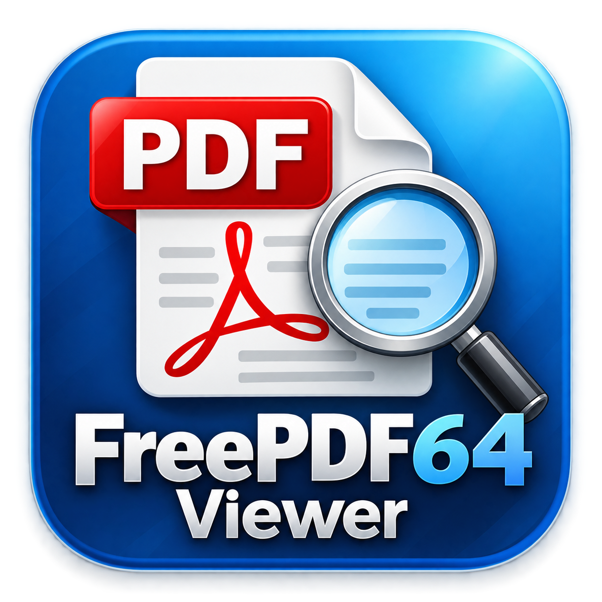
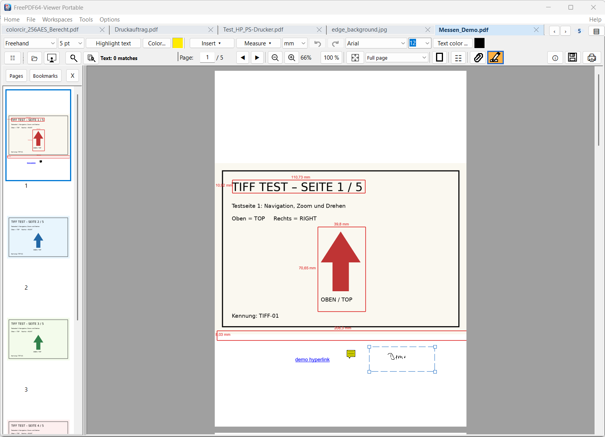
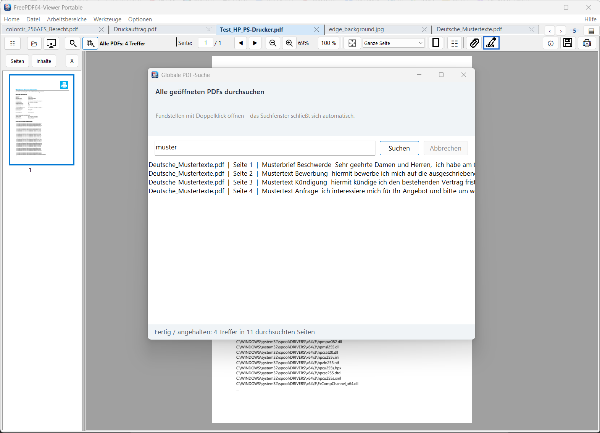
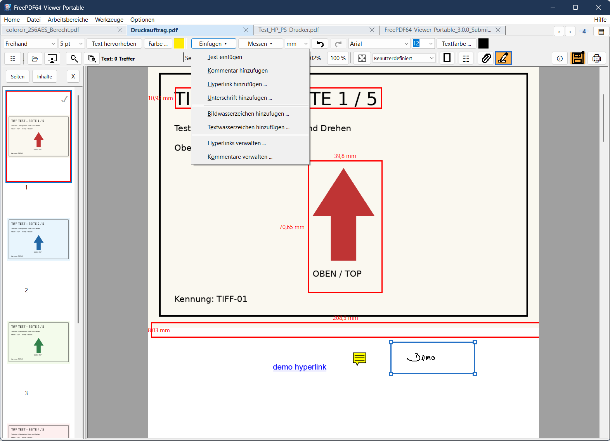

# FreePDF64-Viewer Portable 3.5.0

**Free, open-source PDF and image viewer for Windows – portable, fast and versatile.**

**No ads · No AI features · No subscriptions** | **Werbefrei · Keine KI-Funktionen · Keine Abonnements**

[English](#english) · [Deutsch](#deutsch)

[**Download / Releases**](https://github.com/FreePDF64/FreePDF64ViewerPortable/releases) · [**Project page**](https://github.com/FreePDF64/FreePDF64ViewerPortable)

*FreePDF64-Viewer Portable – main window and VCL Ribbon. Click to enlarge.*

---

# English

FreePDF64-Viewer Portable is a free, open-source PDF viewer for Windows. It combines a fast PDF and image viewer with tabs, **named, reusable workspaces**, cross-document search, side-by-side viewing, and practical PDF tools. Save a collection of open documents and return to it later instead of reopening every file individually. Settings are stored locally in the application folder.

## Privacy and independence

FreePDF64-Viewer Portable contains no advertising, uses no artificial intelligence (AI) and requires no subscription. PDF processing takes place locally on your computer.

## New in version 3.5.0

- **Smoother PDF navigation:** Optimized scrolling, rendering and synchronized scrolling in side-by-side view, with particular attention to large PDFs and high-DPI displays.
- **Improved hand tool:** Pan PDF pages horizontally and vertically using the hand tool, Alt + left mouse button, or the middle mouse button. Open-hand and grabbing-hand cursors provide clearer feedback.
- **Adaptive Ribbon layout:** Column widths are calculated from text, icons and DPI scaling. Reorganized File, Send, Export and Options groups, single-line theme labels and clearer measurement and redaction controls improve usability on WQHD and 4K displays.
- **Improved workspace management:** More compact management window, clearer labels and confirmation messages, and a dedicated **Restore workspace** command.
- **Refined bilingual interface:** Updated German and English labels, tooltips, icons and feature help.
- **Bug fixes:** Corrected attachment selection and action states for extraction and removal, and fixed the missing taskbar icon when launching the viewer directly with a file from Windows Explorer or the command line.

### Highlights from earlier releases (3.2.0–3.4.2)

- Custom VCL Ribbon with embedded monochrome icons, automatic width adjustment, editable zoom percentage and high-DPI support.
- Edit PDF metadata and supported existing text, image and vector objects, with Undo/Redo and safety checks.
- Insert and extract PDF images, export pages, view document fonts and navigate multipage TIFF files.
- Signatures, measurement tools, hyperlink editing, optical and permanent redaction.
- Side-by-side PDF comparison, improved saving with unsaved-change indicators, and email sharing of PDF and image files.
- Improved PDFium integration, interface themes, bilingual tooltips and portable operation.

## Key features

- **VCL Ribbon:** Adaptive column widths, organized commands with embedded monochrome icons and an editable PDF zoom-percentage field.
- **Tabs and workspaces:** Open multiple PDFs and images in tabs, save named workspaces, and restore collections of documents and their zoom settings.
- **Side-by-side comparison:** View two PDFs together; **S** synchronizes scrolling and **Z** synchronizes zoom (left → right).
- **Navigation:** Smooth scrolling and mouse panning with the hand tool or middle mouse button.
- **Search:** Search one PDF or all open PDFs using **Ctrl+Shift+F**.
- **Page management:** Resizable thumbnails; drag and drop pages to reorder, rotate, delete, or extract them.
- **PDF editing:** Move, resize and rotate supported existing text, image and vector objects; insert images, text, comments, drawings, highlights, watermarks, and clickable hyperlinks; Undo/Redo for supported edits.
- **PDF forms:** Edit AcroForm and supported static XFA forms; run supported V8 JavaScript actions and calculations.
- **Images:** Open, zoom, rotate, and save JPG/JPEG, PNG, BMP, and single- or multipage TIFF files; preview and extract embedded PDF images.
- **More:** View PDF font information, manage attachments, export PDF pages as images or text, use bookmarks, switch between German and English, and choose interface themes.

## Workspaces – pick up where you left off

**Workspaces are a standout feature of FreePDF64-Viewer Portable:** Instead of reopening documents one by one, save the currently open PDFs and supported images as a **named workspace** and reopen that collection whenever you need it. This is particularly useful for recurring projects, research, or working with several related documents.

- **Save and restore:** Keep multiple named workspaces and reopen their documents, including saved zoom levels.
- **Manage efficiently:** Search, sort, inspect workspace contents, rename, and delete saved workspaces in a dedicated management window.
- **Portable workflow:** Workspace management is integrated into the viewer, without a separate project-management application.

See the **Workspaces** screenshot below for the management interface.

## Screenshots

*Click a thumbnail to open the full-size image.*

## Quick start

1. Extract the entire release ZIP to a folder, keeping bundled libraries and auxiliary tools.
2. Run **`FreePDF64ViewerPortable.exe`**.
3. Open PDFs using **Ctrl+O**, drag and drop, or Windows File Explorer. Supported image files can also be opened.

**Notes:** Measurements depend on the drawing scale and source PDF. **Visual redaction** only covers content; it does not securely remove it. Not every PDF JavaScript feature or XFA form is supported. Existing-object editing is limited to supported page objects; pages containing unsupported object types are protected from object transformations.

## Portable use and license

Settings are stored in **`FreePDFViewer.ini`** in the application folder.

**FreePDF64-Viewer Portable** is free and open-source software licensed under **GNU GPL v3 (GPL-3.0-only)**. Use, modification, and redistribution are subject to this license. See **`LIZENZ_DE.txt`** (German) and **`LICENSE_NOTICE_EN.txt`** (English).

**Third-party libraries and tools:**
- **[PDFium](https://pdfium.googlesource.com/pdfium/):** PDF rendering and processing, © The PDFium Authors.
- **[V8](https://v8.dev/):** JavaScript engine, © The V8 Project Authors.

License texts and copyright notices for PDFium, V8, and bundled third-party libraries are included in the **`PDFium`** subfolder (**`LICENSE`** file and **`licenses`** directory). Their respective license terms must be observed when redistributing the software. FreePDF64-Viewer Portable is **not an official product of PDFium, V8, or Google**.

**Contact:** [FreePDF64@outlook.com](mailto:FreePDF64@outlook.com) · [GitHub](https://github.com/FreePDF64/FreePDF64ViewerPortable)

---

# Deutsch

FreePDF64-Viewer Portable ist ein kostenloser Open-Source-PDF-Viewer für Windows. Er vereint einen schnellen PDF- und Bildbetrachter mit Registerkarten, **benannten und wiederverwendbaren Arbeitsbereichen**, dokumentübergreifender Suche, Zweifensteransicht und praktischen PDF-Werkzeugen. Zusammengehörige Dokumente lassen sich als Arbeitsbereich speichern und später bequem wieder öffnen. Die Einstellungen bleiben lokal im Programmordner.

## Datenschutz und Unabhängigkeit

FreePDF64-Viewer Portable enthält keine Werbung, setzt keine künstliche Intelligenz (KI) ein und erfordert kein Abonnement. Die PDF-Verarbeitung erfolgt lokal auf deinem Computer.

## Neu in Version 3.5.0

- **Flüssigere PDF-Navigation:** Optimiertes Scrollen, Rendering und synchronisiertes Scrollen in der Zweifensteransicht, insbesondere für große PDFs und Bildschirme mit hoher DPI-Skalierung.
- **Verbessertes Handwerkzeug:** PDF-Seiten horizontal und vertikal mit dem Handwerkzeug, Alt + linker Maustaste oder gedrückter mittlerer Maustaste verschieben. Offene und greifende Hand als Mauszeiger verdeutlichen den aktuellen Zustand.
- **Adaptives Ribbon-Layout:** Spaltenbreiten werden anhand von Text, Symbolen und DPI-Skalierung automatisch berechnet. Neu organisierte Gruppen für Datei, Senden, Export und Optionen, einzeilige Designbeschriftungen sowie verständlichere Mess- und Schwärzungswerkzeuge verbessern die Bedienung unter WQHD und 4K.
- **Verbesserte Arbeitsbereichsverwaltung:** Kompakteres Verwaltungsfenster, verständlichere Beschriftungen und Bestätigungsmeldungen sowie der Befehl **„Arbeitsbereich wiederherstellen“**.
- **Überarbeitete zweisprachige Oberfläche:** Aktualisierte deutsche und englische Beschriftungen, Tooltips, Symbole und Funktionsübersicht.
- **Fehlerkorrekturen:** Korrigierter Auswahl- und Schaltflächenstatus beim Extrahieren und Entfernen von PDF-Anlagen sowie behobenes Taskleistensymbol beim direkten Start mit einer Datei über den Windows-Explorer oder die Kommandozeile.

### Highlights früherer Versionen (3.2.0–3.4.2)

- Eigenes VCL-Ribbon mit eingebetteten einfarbigen Symbolen, automatischer Breitenanpassung, editierbarer Zoom-Prozentanzeige und Unterstützung hoher DPI-Auflösungen.
- PDF-Metadaten und unterstützte vorhandene Text-, Bild- und Vektorobjekte bearbeiten, mit Rückgängig/Wiederholen und Sicherheitsprüfungen.
- PDF-Bilder einfügen und extrahieren, Seiten exportieren, Dokumentenschriftarten anzeigen und durch mehrseitige TIFF-Dateien navigieren.
- Unterschriften, Messwerkzeuge, Hyperlink-Bearbeitung sowie optische und endgültige Schwärzung.
- PDF-Vergleich in geteilter Ansicht, verbesserte Speicherung mit Kennzeichnung ungespeicherter Änderungen und E-Mail-Versand von PDF- und Bilddateien.
- Verbesserte PDFium-Integration, Designs, zweisprachige Tooltips und portable Nutzung.

## Funktionen im Überblick

- **VCL-Ribbon:** Adaptive Spaltenbreiten, übersichtlich angeordnete Befehle mit eingebetteten einfarbigen Symbolen und editierbarer PDF-Zoom-Prozentanzeige.
- **Registerkarten und Arbeitsbereiche:** Mehrere PDFs und Bilder in Registerkarten öffnen, benannte Arbeitsbereiche speichern und Dokumente samt Zoom-Einstellungen wiederherstellen.
- **PDF-Vergleich:** Zwei PDFs nebeneinander anzeigen; **S** synchronisiert das Scrollen, **Z** den Zoom (jeweils links → rechts).
- **Navigation:** Flüssiges Scrollen und Verschieben mit dem Handwerkzeug oder der mittleren Maustaste.
- **Suche:** Einzelne PDFs durchsuchen oder alle geöffneten PDFs gemeinsam mit **Strg+Umschalt+F**.
- **Seitenverwaltung:** Vergrößerbare Miniaturen; Seiten per Drag & Drop verschieben, drehen, löschen oder extrahieren.
- **PDF-Bearbeitung:** Unterstützte vorhandene Text-, Bild- und Vektorobjekte verschieben, skalieren und drehen; Bilder, Text, Kommentare, Zeichnungen, Markierungen, Wasserzeichen und anklickbare Hyperlinks hinzufügen; Rückgängig/Wiederholen für unterstützte Bearbeitungen.
- **PDF-Formulare:** AcroForm und unterstützte statische XFA-Formulare bearbeiten; unterstützte JavaScript-V8-Aktionen und Berechnungen ausführen.
- **Bilder:** JPG/JPEG, PNG, BMP sowie ein- und mehrseitige TIFF-Dateien öffnen, zoomen, drehen und speichern; eingebettete PDF-Bilder anzeigen und extrahieren.
- **Weitere Funktionen:** PDF-Schriftarten anzeigen, PDF-Anlagen verwalten, PDF-Seiten als Bilder oder Text exportieren, Inhaltsverzeichnis, DE/EN-Oberfläche und verschiedene Designs.

## Arbeitsbereiche – dort weitermachen, wo du aufgehört hast

**Die Arbeitsbereiche sind ein besonderes Merkmal von FreePDF64-Viewer Portable:** Statt Dokumente jedes Mal einzeln zu öffnen, lassen sich die aktuell geöffneten PDFs und unterstützten Bilder als **benannter Arbeitsbereich** speichern und bei Bedarf gemeinsam wieder aufrufen. Ideal für wiederkehrende Projekte, Recherchen und die Arbeit mit mehreren zusammengehörigen Dokumenten.

- **Speichern und wiederherstellen:** Mehrere benannte Arbeitsbereiche verwalten und die enthaltenen Dokumente einschließlich gespeicherter Zoom-Einstellungen erneut öffnen.
- **Komfortabel verwalten:** Arbeitsbereiche in einem eigenen Fenster durchsuchen, sortieren, Inhalte anzeigen, umbenennen und löschen.
- **Portabel arbeiten:** Die Arbeitsbereichsverwaltung ist direkt in den Viewer integriert – ohne zusätzliches Projektverwaltungsprogramm.

Der Screenshot **Arbeitsbereiche** weiter unten zeigt die Verwaltung.

## Screenshots

*Klicke auf ein Vorschaubild, um die vollständige Ansicht zu öffnen.*

## Schnellstart

1. Release-ZIP vollständig in einen Ordner entpacken; mitgelieferte Bibliotheken und Zusatzprogramme beibehalten.
2. **`FreePDF64ViewerPortable.exe`** starten.
3. PDFs über **Strg+O**, Drag & Drop oder den Windows-Explorer öffnen. Unterstützte Bilddateien können ebenfalls geöffnet werden.

**Hinweise:** Messwerte hängen vom Maßstab und der PDF-Vorlage ab. Die **optische Schwärzung** verdeckt Inhalte nur und entfernt sie nicht sicher. PDF-JavaScript und XFA werden nicht in allen Varianten unterstützt. Die Bearbeitung vorhandener Objekte ist auf unterstützte Seitenobjekte begrenzt; Seiten mit nicht unterstützten Objekttypen sind vor Objekttransformationen geschützt.

## Portabilität und Lizenz

Die Einstellungen werden in **`FreePDFViewer.ini`** im Programmordner gespeichert.

**FreePDF64-Viewer Portable** ist freie und quelloffene Software unter der **GNU GPL v3 (GPL-3.0-only)**. Nutzung, Änderung und Weitergabe richten sich nach dieser Lizenz. Der deutsche Lizenzhinweis steht in **`LIZENZ_DE.txt`**, der englische in **`LICENSE_NOTICE_EN.txt`**.

**Zusatzprogramme und Bibliotheken:**
- **[PDFium](https://pdfium.googlesource.com/pdfium/):** PDF-Darstellung und -Verarbeitung, © The PDFium Authors.
- **[V8](https://v8.dev/):** JavaScript-Engine, © The V8 Project Authors.

Die Lizenztexte und Copyright-Hinweise zu PDFium, V8 und eingebundenen Drittanbieter-Bibliotheken befinden sich im mitgelieferten Unterordner **`PDFium`** (Datei **`LICENSE`** und Ordner **`licenses`**). Bei der Weitergabe sind die jeweiligen Lizenzbedingungen zu beachten. FreePDF64-Viewer Portable ist **kein offizielles Produkt von PDFium, V8 oder Google**.

**Kontakt:** [FreePDF64@outlook.com](mailto:FreePDF64@outlook.com) · [GitHub](https://github.com/FreePDF64/FreePDF64ViewerPortable)

---

Copyright © 2026 FreePDF64

