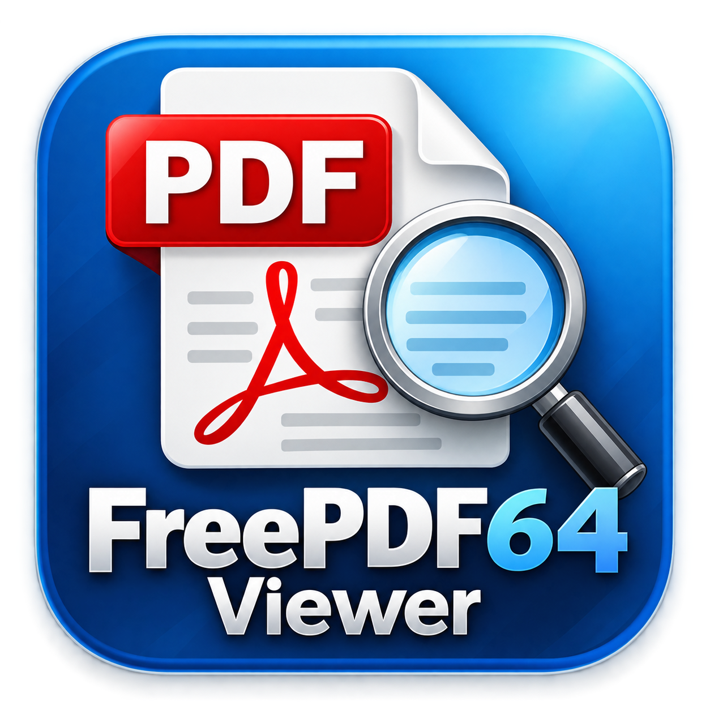
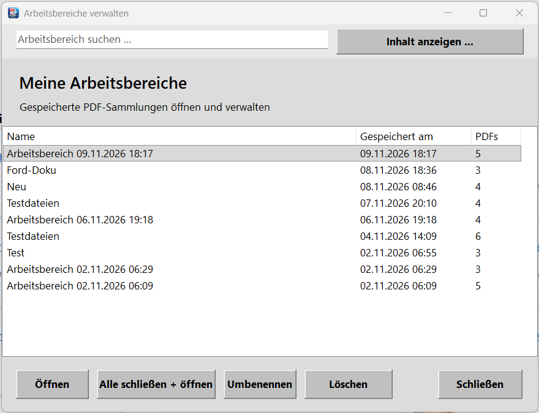
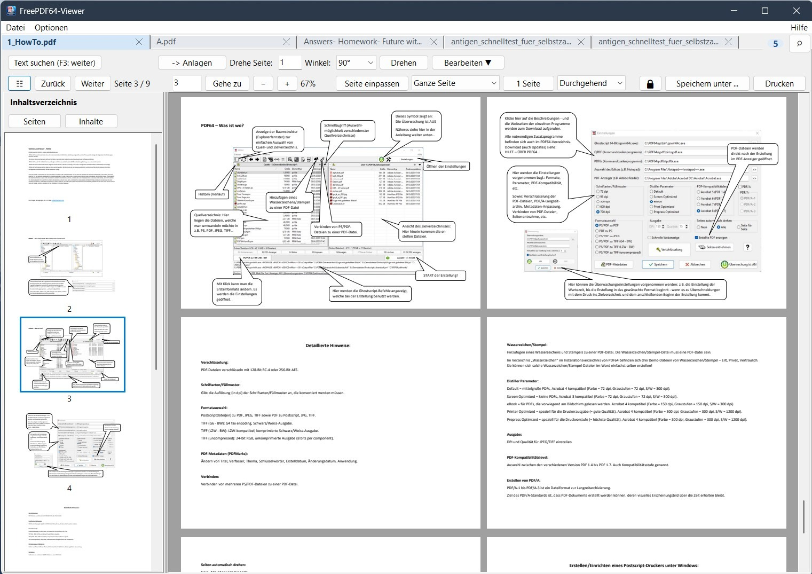
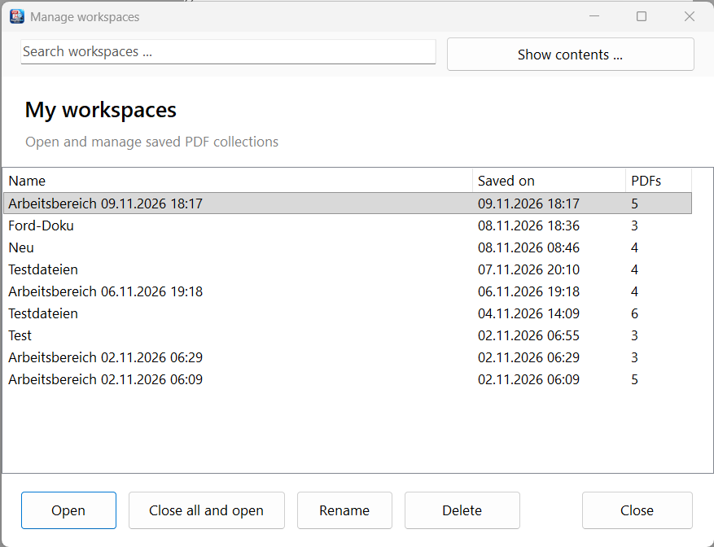
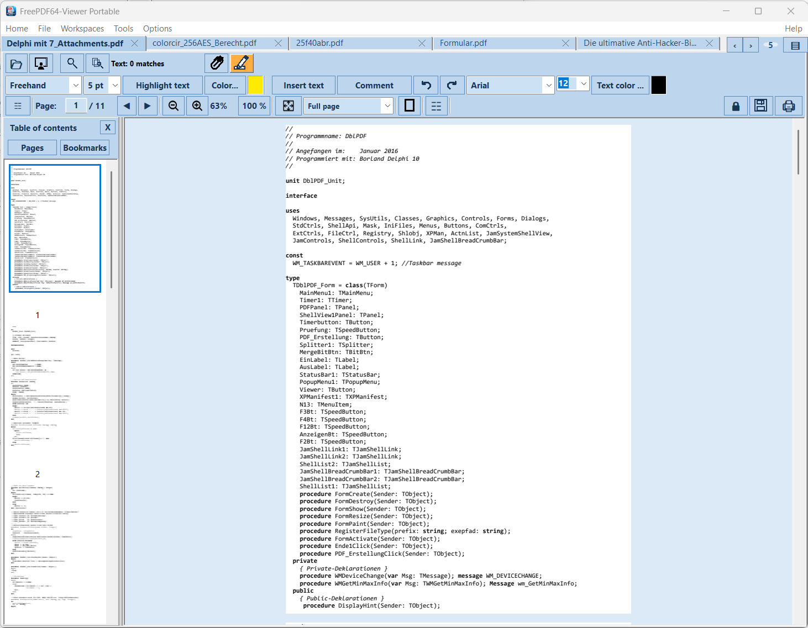

# FreePDF64-Viewer Portable 3.1.3

[Deutsch](#deutsch) · [English](#english)

---

# Deutsch

**Mehr als ein PDF-Reader: PDFs und Bilder in Registerkarten öffnen, zwei PDFs nebeneinander vergleichen, Dokumente gemeinsam durchsuchen und Arbeitsbereiche speichern.**

Ein kostenloser, eigenständig nutzbarer und portabler PDF- und Bild-Viewer für Windows mit Registerkarten, dokumentübergreifender PDF-Suche, interaktiven PDF-Formularen und integrierten Werkzeugen.

[**Download / Releases**](https://github.com/FreePDF64/FreePDF64ViewerPortable/releases) · [**Projektseite**](https://github.com/FreePDF64/FreePDF64ViewerPortable) · [**Fragen und Anregungen**](mailto:FreePDF64@outlook.com?subject=Fragen%2FAnregungen%20zu%20FreePDF64ViewerPortable)

## Neu in Version 3.1.3: Wasserzeichen, Hyperlinks und verbesserte Bedienung

Version **3.1.3** erweitert die PDF-Bearbeitung um Wasserzeichen und anklickbare Hyperlinks. Die Funktionen stehen **ausschließlich für PDF-Dateien** zur Verfügung, nicht für JPG, PNG, BMP oder TIFF.

- **Textwasserzeichen:** Eigenen Text mit wählbarer Schriftgröße, Deckkraft und Drehwinkel auf der aktuellen oder auf allen PDF-Seiten einfügen.
- **Bildwasserzeichen:** PNG- oder JPG-Bilder mit einstellbarer Größe, Deckkraft und Drehwinkel als Wasserzeichen einfügen – auf der aktuellen oder auf allen PDF-Seiten.
- **Sichtbare Hyperlinks:** Einen Bereich auf der PDF-Seite mit der Maus aufziehen und einen **Anzeigetext** sowie eine **Webadresse oder E-Mail-Adresse** festlegen. Der Linktext erscheint **blau und unterstrichen**.
- **Hyperlinks bedienen und verschieben:** Beim Überfahren wird das Linkziel als Hinweis angezeigt; der Mauszeiger wechselt zur Hand. Mit **Strg + gedrückter linker Maustaste** lassen sich eingefügte Hyperlinks samt Text, Unterstrich und Linkbereich verschieben. Ohne Strg bleibt der Link normal anklickbar.
- **Änderungen speichern:** Wasserzeichen und Hyperlinks werden in der PDF gespeichert und bleiben nach erneutem Öffnen erhalten.
- **Funktionsübersicht:** Deutsche und englische Funktionsübersicht um die neuen Werkzeuge ergänzt; ein **anklickbares Inhaltsverzeichnis** erleichtert die Navigation.
- **Werkzeugleiste:** Beim Schließen von „Werkzeuge“ werden die Modi **„Text einfügen“** und **„Kommentar“** deaktiviert; bereits eingefügte Inhalte bleiben erhalten.

**Bedienung:** Die neuen Befehle **„Hyperlink hinzufügen …“**, **„Bildwasserzeichen hinzufügen …“** und **„Textwasserzeichen hinzufügen …“** stehen im Kontextmenü der PDF-Miniaturansicht zur Verfügung.

## Bereits in Version 3.1.2: JavaScript-V8 und statische XFA-Formulare

Version **3.1.2** erweitert die Formularunterstützung des Viewers:

- **PDFium mit V8-JavaScript:** Unterstützte JavaScript-Aktionen in interaktiven PDF-Formularen können ausgeführt werden.
- **Automatische Formularberechnungen:** Abhängige Werte werden nach Eingaben und Änderungen an unterstützten Checkboxen und Optionsfeldern aktualisiert – auch über mehrere PDF-Seiten hinweg.
- **AcroForm-Bearbeitung:** Textfelder, Checkboxen, Optionsfelder und weitere unterstützte Formularfelder ausfüllen und die Änderungen speichern.
- **Statische XFA-Formulare:** Unterstützte statische XFA-Formulare bearbeiten und speichern. Beim Speichern werden die bearbeiteten Formularwerte mit den XFA-XML-Datensätzen synchronisiert.
- **Verbesserte Tastaturbedienung:** Formularfelder mit **TAB** und **Umschalt+TAB** durchlaufen; die Bearbeitung und Übernahme der Werte bleibt erhalten.
- **Anpassbare Benutzeroberfläche (Designs):** Es stehen zur Verfügung: Standard, Modern Hell, Windows Klassik, Klassisch Blau.
- **Updatefunktion**

> **Hinweis zur Kompatibilität:** Nicht jedes PDF-JavaScript und nicht jedes XFA-Formular wird unterstützt. Insbesondere ist die Unterstützung **statischer XFA-Formulare** nicht mit einer vollständigen Unterstützung dynamischer XFA-Layouts gleichzusetzen. Das Verhalten hängt von der Struktur des jeweiligen Dokuments ab.

## Neu: Bilder und mehrseitige TIFF-Dateien anzeigen und bearbeiten

Neben PDFs lassen sich jetzt auch **JPG, JPEG, PNG, BMP sowie ein- und mehrseitige TIFF-Dateien** direkt im Viewer öffnen. PDFs und Bilder können gleichzeitig in eigenen Registerkarten geöffnet bleiben.

- **Eigene Bild-Symbolleiste:** Bilder vergrößern und verkleinern, auf **100 %** zurücksetzen, an die ganze Ansicht oder die Breite anpassen sowie speichern und drucken.
- **Zoom mit Strg + Mausrad:** Die Zoomstufe lässt sich auch mit der Maus ändern; die aktuelle Vergrößerung wird in Prozent angezeigt.
- **Schnelles Drehen:** Bilder um **90° nach links oder rechts** drehen, ohne die PDF-Funktionen zu beeinflussen.
- **Mehrseitige TIFFs:** Zwischen den einzelnen Seiten navigieren, Seiten unabhängig voneinander drehen und die bearbeitete mehrseitige TIFF-Datei über **„Speichern unter …“** sichern.
- **Änderungen erkennen:** Bei bearbeiteten Bilder zeigt ein orangefarbenes Speichersymbol an, dass noch nicht gespeicherte Änderungen vorliegen.
- **Registerkartenvorschau:** Beim Zeigen auf eine Bild-Registerkarte erscheint ein kleines Vorschaubild – auch ohne die Registerkarte zuvor anzuklicken. Bei bereits geladenen Bildern berücksichtigt die Vorschau die aktuelle Drehung beziehungsweise TIFF-Seite.
- **Gemeinsame Registerkartenverwaltung:** PDFs und Bilder lassen sich nebeneinander geöffnet halten; **„PDFs zusammenführen …“** listet weiterhin ausschließlich PDF-Dateien auf.

**Hinweis zu TIFF:** Beim Speichern mehrseitiger TIFF-Dateien werden die Bilddaten neu codiert. Die ursprüngliche Kompression und Metadaten bleiben daher nicht zwangsläufig unverändert erhalten.

## Das macht den Viewer besonders

**Viele PDFs, zwei Ansichten, eine Suche, wiederverwendbare Arbeitsbereiche.** FreePDF64-Viewer Portable richtet sich an alle, die regelmäßig mit mehreren PDF-Dokumenten arbeiten und mehr benötigen als das bloße Anzeigen einzelner Dateien im Browser.

- ↔️ **Zweifensteransicht zum PDF-Vergleich:** Zwei PDFs gleichzeitig nebeneinander anzeigen. Mit **S** das Scrollen vom linken zum rechten PDF synchronisieren und mit **Z** Zoomänderungen vom linken zum rechten PDF übertragen. Beide Schalter lassen sich unabhängig aktivieren oder deaktivieren.
- 🔎 **Alle geöffneten PDFs gleichzeitig durchsuchen:** Die globale Volltextsuche durchsucht die Dokumente aller geöffneten Registerkarten. Treffer werden dokumentübergreifend aufgelistet; per Doppelklick springst du direkt zur Fundstelle – auch wenn das betreffende PDF zuvor noch nicht angezeigt wurde. Aufruf über **„Alle PDFs durchsuchen“** oder **Strg+Umschalt+F**.
- 🗂️ **Arbeitsbereiche speichern und wieder öffnen:** Stelle häufig benötigte PDF-Gruppen zusammen, speichere sie unter einem eigenen Namen und rufe sie später wieder auf. Mehrere Arbeitsbereiche lassen sich verwalten, umbenennen und löschen. So wird aus einer einmaligen PDF-Sitzung ein wiederverwendbarer Dokumentenbestand.
- ⚡ **Schneller Start und reaktionsfähige Oberfläche:** PDFs werden verzögert beziehungsweise asynchron geladen, damit das Hauptfenster rasch benutzbar ist. Auch die Suche nach eingebetteten PDF-Anlagen wurde auf eine asynchrone Verarbeitung umgestellt. Besonders bei umfangreichen Dokumenten ist das hilfreich.
- 📑 **PDFs und Bilder in einer Anwendung:** Registerkarten und Vorschauen erleichtern den Überblick. PDF-Dokumente und unterstützte Bilddateien lassen sich gleichzeitig öffnen.
- 🖼️ **Flexible Miniaturansichten:** Seitenvorschauen lassen sich vergrößern, um Details leichter zu erkennen. Seiten können mit gedrückter linker Maustaste neu angeordnet werden. Über das Kontextmenü lassen sich ausgewählte Seiten außerdem löschen, drehen oder extrahieren.
- 🧾 **Interaktive Formulare:** AcroForm- und unterstützte statische XFA-Formulare bearbeiten und speichern; unterstützte JavaScript-V8-Berechnungen werden aktualisiert.
- 🛠️ **PDF-Werkzeuge direkt integriert:** Seiten drehen, verschieben, löschen oder extrahieren, Anlagen verwalten, Markierungen, Wasserzeichen und anklickbare Hyperlinks hinzufügen – ohne für jede Aufgabe zu einer anderen Ansicht wechseln zu müssen.

## Warum FreePDF64-Viewer Portable statt Browser oder gewöhnlichem PDF-Reader?

> **Eine Anwendung. Mehrere PDFs. Ein durchgängiger Arbeitsablauf.**
>
> Für das gelegentliche Lesen einer einzelnen PDF reicht die Browseranzeige oft aus. Wer regelmäßig mit mehreren Dokumenten arbeitet, profitiert dagegen von Funktionen, die hier unmittelbar zusammenspielen:
>
> - **Zwei PDFs direkt vergleichen** – nebeneinander, mit optional synchronisiertem Scrollen (**S**) und Zoomen (**Z**).
> - **Alle geöffneten PDFs gemeinsam durchsuchen** – Fundstellen dokumentübergreifend finden und direkt anspringen.
> - **Arbeitsbereiche speichern und wieder öffnen** – häufig benötigte Dokumentgruppen jederzeit erneut aufrufen.
> - **Registerkarten und PDF-Werkzeuge nutzen** – Seiten verwalten und Dokumente bearbeiten, ohne ständig zwischen Anwendungen zu wechseln.
>
> **Der entscheidende Vorteil:** Diese Möglichkeiten sind in einer **kostenlosen, portablen Windows-Anwendung** vereint. Statt mehrere Browserfenster und getrennte Werkzeuge zu koordinieren, bleibt die Dokumentarbeit an einem Ort.

*Fairer Vergleich: Andere PDF-Reader können einzelne oder auch mehrere dieser Funktionen ebenfalls bieten. FreePDF64-Viewer Portable setzt auf ihre praktische Kombination im täglichen Arbeitsablauf.*

## Zwei PDFs nebeneinander vergleichen – Zweifensteransicht

Die **Zweifensteransicht** eignet sich besonders für den Vergleich zweier Dokumentversionen, Verträge, Anleitungen oder umfangreicher Unterlagen. Beide PDFs sind gleichzeitig sichtbar, sodass du Inhalte direkt gegenüberstellen kannst, statt ständig zwischen Registerkarten zu wechseln.

- **Zwei Dokumente parallel betrachten:** Linkes und rechtes PDF in einer gemeinsamen Ansicht anzeigen.
- **S – Synchrones Scrollen:** Beim Scrollen im **linken PDF** wird die rechte Ansicht mitgeführt. Über **S** lässt sich diese Kopplung ein- und ausschalten.
- **Z – Synchroner Zoom:** Änderungen der Zoomstufe im **linken PDF** werden auf die rechte Ansicht übertragen. Über **Z** lässt sich diese Kopplung ein- und ausschalten.
- **Unabhängige Steuerung:** Nur Scrollen, nur Zoom, beides oder keine Synchronisierung – je nach Vergleichsaufgabe. Aktivierte Schalter bleiben gedrückt und erscheinen fett.

**Praktischer Vorteil:** Zwei Fassungen lassen sich direkt vergleichen, während du die Ansichten bei Bedarf gemeinsam bewegst oder vergrößerst. Die Synchronisierung läuft **vom linken zum rechten PDF**, nicht umgekehrt; eine automatische inhaltliche Ausrichtung unterschiedlicher Seiten ist damit nicht gemeint.

## Arbeitsbereiche komfortabel verwalten

*Gespeicherte Arbeitsbereiche auf einen Blick: nach Speicherdatum sortiert, mit PDF-Anzahl und den Aktionen Öffnen, Umbenennen und Löschen.*

## So sieht FreePDF64-Viewer Portable aus 

*Der Viewer mit Registerkarten, Seitenvorschau, Dokumentanzeige und PDF-Werkzeugen.*

## Miniaturansichten: Seiten direkt verwalten

Die Miniaturansicht dient nicht nur zur Navigation, sondern bietet praktische Funktionen zur Seitenverwaltung:

- **Vorschauen vergrößern:** Miniaturansichten lassen sich für eine bessere Übersicht vergrößern.
- **Seiten per Drag & Drop verschieben:** Seiten mit gedrückter **linker Maustaste** innerhalb der Miniaturansicht an eine andere Position ziehen.
- **Ausgewählte Seite(n) löschen:** Markierte Seiten über das Kontextmenü entfernen.
- **Ausgewählte Seite(n) drehen:** Seiten um **90° im Uhrzeigersinn** oder **90° gegen den Uhrzeigersinn** drehen.
- **Seite(n) extrahieren:** Ausgewählte Seiten über **„Seite(n) extrahieren …“** extrahieren.
- **Pflichtfelder prüfen:** Die Prüfung über **„Pflichtfelder prüfen …“** oder **F7** aufrufen.
- **PDF neu laden:** Über **„PDF neu laden (Änderungen verwerfen)“** das Dokument erneut laden; ungespeicherte Änderungen werden nur nach Rückfrage verworfen.

Die Aktionen stehen über das **Kontextmenü der Miniaturansicht** zur Verfügung.

## Weitere Funktionen im Überblick

- **Zweifensteransicht:** Zwei PDFs parallel anzeigen; **S** synchronisiert das Scrollen und **Z** den Zoom jeweils vom linken zum rechten Dokument. Beide Funktionen sind unabhängig schaltbar.
- **PDFs und Bilder in einem Fenster:** Jedes Dokument beziehungsweise Bild erhält eine eigene Registerkarte. Auch mehrere PDF-Dateien aus dem Windows-Datei-Explorer können im bereits laufenden Viewer geöffnet werden.
- **Bildfunktionen:** JPG, JPEG, PNG, BMP und TIFF öffnen, zoomen, einpassen, um 90° drehen, speichern und drucken; mehrseitige TIFFs seitenweise navigieren und mit individuellen Drehungen speichern.
- **Registerkartenvorschau für Bilder:** Bildvorschau beim Überfahren der Registerkarte mit der Maus.
- **Nur eine Programminstanz:** Ein erneuter Start aktiviert den vorhandenen Viewer, statt ein zweites Fenster zu öffnen.
- **Registerkarten bequem verwalten:** Tabs über das kleine **×** oder mit **Strg+W** schließen; offene Tabs über die **Lupe** oder **Strg+Umschalt+A** suchen. Die Suche lässt sich mit derselben Tastenkombination oder **Esc** wieder schließen.
- **Flexible PDF-Anzeige:** Vergrößerbare Seitenminiaturen, Inhaltsverzeichnis, Zoom, Seitennavigation sowie verschiedene Seiten- und Ansichtsmodi. Seiten lassen sich in der Miniaturansicht mit gedrückter linker Maustaste verschieben.
- **PDF-Werkzeuge:** Unter anderem Seiten drehen, nach oben/unten verschieben, löschen, extrahieren, Dokumenteigenschaften anzeigen und PDF-Anlagen verwalten.
- **PDF-Wasserzeichen:** Text- oder Bildwasserzeichen mit Größe, Deckkraft und Drehwinkel auf der aktuellen oder allen PDF-Seiten hinzufügen.
- **PDF-Hyperlinks:** Blauen, unterstrichenen Linktext mit Web- oder E-Mail-Ziel einfügen, Linkziel-Hint anzeigen und den Link mit **Strg + linker Maustaste** verschieben.
- **Formulare ausfüllen:** AcroForm- und unterstützte statische XFA-Felder bearbeiten und speichern; JavaScript-V8-Aktionen und automatische Berechnungen werden unterstützt.
- **PDF bearbeiten:** Freihandzeichnungen, Linien, Rechtecke und Ellipsen als Markierungen hinzufügen.
- **Optische Schwärzung:** Textbereiche mit schwarzen Rechtecken überdecken (keine sichere Entfernung des Textes).
- **PDF neu laden:** Das aktuelle Dokument über **Datei → PDF neu laden (Änderungen verwerfen)** erneut öffnen; vor dem Verwerfen ungespeicherter Änderungen wird nachgefragt.
- **Sitzung wiederherstellen:** Zuletzt geöffnete PDF- und Bilddateien sowie die letzte Sitzung über das Kontextmenü der leeren Startseite erneut öffnen.
- **Windows-Integration:** PDF-Dateien optional mit dem Viewer verknüpfen und direkt per Doppelklick öffnen.
- **Infobereich:** Den Viewer auf Wunsch beim Schließen in den Windows-Infobereich verschieben.

## Verbesserungen bei Anzeige und Bearbeitung

- **Asynchrones Laden:** PDF-Dateien können verzögert geladen werden, sodass das Viewer-Fenster zügig erscheint und bedienbar bleibt.
- **Asynchrone Anlagenerkennung:** Eingebettete PDF-Anlagen werden mit QPDF geprüft, ohne den Start durch eine lange synchrone Prüfung zu blockieren.
- **Schnelle erste Seitenanzeige:** Die erste sichtbare PDF-Seite wird beim Aufbau bevorzugt behandelt.
- **Rendercache:** Bereits berechnete Seitenbilder können wiederverwendet werden, um unnötiges Neurendern zu reduzieren.
- **Bedarfsgesteuerte Miniaturansichten:** Seitenvorschauen werden nach Bedarf aufgebaut. Die Miniaturen lassen sich vergrößern; Seiten können per Ziehen mit gedrückter linker Maustaste direkt in der Vorschau verschoben werden.
- **Direkte Seitendrehung:** Drehungen erfolgen über PDFium im Speicher, ohne dafür zunächst eine temporäre PDF-Datei anzulegen; betroffene Anzeige- und Größencaches werden aktualisiert.

Diese Maßnahmen verbessern insbesondere Start und Bedienbarkeit. Sie bedeuten nicht, dass das Rendern selbst vollständig im Hintergrund stattfindet: Das Rendering erfolgt weiterhin im VCL-Hauptthread; ein eigenständiger Hintergrund-Render-Worker ist nicht Bestandteil dieser Version. Konkrete Geschwindigkeitsgewinne hängen vom PDF-Dokument und vom verwendeten System ab.

> **Wichtig zur optischen Schwärzung:** Ein schwarzes Rechteck verdeckt den darunterliegenden PDF-Text lediglich optisch. Der Text wird **nicht entfernt** und kann weiterhin ausgelesen, kopiert oder wiederhergestellt werden. Die Funktion eignet sich **nicht** zum sicheren Entfernen vertraulicher Informationen.

## Schnellstart

1. Die Dateien des Viewers gemeinsam in einen Ordner entpacken. Benötigte Bibliotheken und Zusatzprogramme müssen dabei erhalten bleiben.
2. **`FreePDF64ViewerPortable.exe`** starten.
3. Über **Datei → PDF öffnen …**, **Strg+O** oder **Drag & Drop** PDF-Dateien öffnen. Unterstützte Bilddateien können ebenfalls im Viewer geöffnet werden.
4. Optional unter **Optionen** die PDF-Dateiverknüpfung für Windows einrichten.

> **Hinweis zur Dateiverknüpfung:** Die Registrierung erfolgt für den aktuellen Windows-Benutzer. Unter Windows 10/11 muss der Viewer gegebenenfalls zusätzlich als Standard-App für `.pdf` ausgewählt werden.

## Bedienung auf einen Blick

| Funktion | Bedienung |
| --- | --- |
| Zweifensteransicht | Zwei PDFs nebeneinander anzeigen; **S** = synchrones Scrollen, **Z** = synchroner Zoom (links → rechts) |
| PDF-Datei öffnen | **Strg+O** oder **Datei → PDF öffnen …** |
| Bilder öffnen | JPG, JPEG, PNG, BMP oder TIFF im Viewer öffnen |
| Bild zoomen | Lupen-Schaltflächen, **Strg + Mausrad**, 100 %, ganze Seite oder Seitenbreite |
| Bild drehen | 90° nach links oder rechts über die Bild-Symbolleiste |
| Mehrseitige TIFFs | Seiten wechseln, einzeln drehen und über **Speichern unter …** als mehrseitige TIFF sichern |
| Aktiven Tab schließen | **Strg+W** oder **×** am Tab |
| Geöffnete Tabs suchen / Suche schließen | **Strg+Umschalt+A**, **Lupe** oder **Esc** zum Schließen |
| Globale Volltextsuche über alle geöffneten PDFs | **Strg+Umschalt+F**, **Alle PDFs durchsuchen** oder **Bearbeiten** |
| Lokale Textsuche im aktuellen PDF | **Text suchen**, **F3** für die weitere Suche |
| Gespeicherte PDF-Arbeitsbereiche verwalten | Menü **Arbeitsbereiche** oder Startseite |
| PDF neu laden | **Datei → PDF neu laden (Änderungen verwerfen)** |
| Markierungen / optische Schwärzung | **Bearbeiten** → Werkzeug auswählen |
| Text- oder Bildwasserzeichen hinzufügen | Rechtsklick in die PDF-Miniaturansicht → **Textwasserzeichen hinzufügen …** / **Bildwasserzeichen hinzufügen …** |
| Hyperlink hinzufügen | Rechtsklick in die PDF-Miniaturansicht → **Hyperlink hinzufügen …**; Linkbereich aufziehen und Text/Ziel eingeben |
| Hyperlink verschieben | **Strg + linke Maustaste** auf dem Hyperlink gedrückt halten und ziehen |
| Viewer beenden | **Datei → Exit** oder **Alt+F4** |
| Hilfe und Programminformationen | Menü **Hilfe** |
| Letzte Sitzung wiederherstellen | Rechtsklick auf die leere Startseite |

Beim Beenden gibt es keine zusätzliche allgemeine Bestätigungsfrage. **Bei ungespeicherten PDF-Änderungen kann weiterhin eine Speicherabfrage erscheinen.**

## Portabler Betrieb

FreePDF64-Viewer Portable ist als eigenständiger Windows-PDF-Viewer ausgelegt. Die Einstellungen werden in **`FreePDFViewer.ini`** im Programmordner gespeichert. Das optionale Startbild **`FreePDF64Viewer_Startbild.jpg`** gehört ebenfalls in diesen Ordner. Bei bestimmten Vorgängen kann **`FreePDF64ViewerLog.txt`** angelegt werden.

Wird die EXE nach einer PDF-Dateiverknüpfung verschoben, muss die Zuordnung unter Umständen erneut eingerichtet werden.

## Lizenz, Zusatzprogramme und Bibliotheken

**FreePDF64-Viewer Portable** ist freie und quelloffene Software und steht unter der **GNU General Public License Version 3 (GNU GPL v3, GPL-3.0-only)**. Nutzung, Änderung und Weitergabe sind gemäß den Bedingungen dieser Lizenz gestattet. Der vollständige Lizenztext ist in der mitgelieferten Datei **`LIZENZ_DE.txt`** enthalten.

Das Programm verwendet folgende Komponenten und Zusatzprogramme, für die jeweils eigene Lizenzbedingungen gelten:

- **PDFium:** Bibliothek zur Darstellung und Verarbeitung von PDF-Dateien, © The PDFium Authors. [PDFium-Projekt](https://pdfium.googlesource.com/pdfium/)
- **V8:** JavaScript-Engine für unterstützte PDF-JavaScript-Funktionen, © The V8 Project Authors. [V8-Projekt](https://v8.dev/)
- **QPDF:** Zusatzwerkzeug für bestimmte PDF-Funktionen; es gelten die Lizenzbedingungen von QPDF.
- **Xpdf:** Zusatzwerkzeuge für bestimmte PDF-Funktionen; es gelten die Lizenzbedingungen von Xpdf.

**PDFium und V8** werden unter ihren jeweiligen Open-Source-Lizenzen eingesetzt. Die vollständigen Lizenzbedingungen, Copyright-Vermerke und Hinweise zu eingebundenen Drittanbieter-Bibliotheken befinden sich im mitgelieferten Unterordner **`PDFium`** (Datei **`LICENSE`** und Ordner **`licenses`**). Bei der Weitergabe des Programms sind die jeweiligen Lizenztexte und Hinweise zu beachten.

FreePDF64-Viewer Portable ist **kein offizielles Produkt von PDFium, V8 oder Google**.

## Kontakt

Fragen, Fehlerberichte, Ideen oder Anregungen?

- **E-Mail:** [FreePDF64@outlook.com](mailto:FreePDF64@outlook.com?subject=Fragen%2FAnregungen%20zu%20FreePDF64ViewerPortable)
- **GitHub:** [FreePDF64ViewerPortable](https://github.com/FreePDF64/FreePDF64ViewerPortable)

**FreePDF64-Viewer Portable – PDF-Dateien und Bilder komfortabel anzeigen und verwalten.**

Copyright © 2026 FreePDF64

---

# English

**More than a PDF reader: Open PDFs and images in tabs, compare two PDFs side by side, search documents together, and save workspaces.**

A free, standalone, portable PDF and image viewer for Windows with tabs, cross-document PDF search, interactive PDF forms, and built-in tools.

[**Download / Releases**](https://github.com/FreePDF64/FreePDF64ViewerPortable/releases) · [**Project page**](https://github.com/FreePDF64/FreePDF64ViewerPortable) · [**Questions and feedback**](mailto:FreePDF64@outlook.com?subject=Questions%2FFeedback%20about%20FreePDF64ViewerPortable)

## New in version 3.1.3: Watermarks, hyperlinks, and usability improvements

Version **3.1.3** adds watermarks and clickable hyperlinks to PDF editing. These features are available **for PDF files only**, not for JPG, PNG, BMP, or TIFF images.

- **Text watermarks:** Add custom text with selectable font size, opacity, and rotation to the current PDF page or all pages.
- **Image watermarks:** Add PNG or JPG images as watermarks, with adjustable size, opacity, and rotation, to the current PDF page or all pages.
- **Visible hyperlinks:** Drag a rectangle on a PDF page, then enter **display text** and a **website or email address**. Link text appears **blue and underlined**.
- **Hover and move links:** Hover to see the link target in a tooltip and a hand cursor. Hold **Ctrl + left mouse button** to move an inserted hyperlink together with its text, underline, and clickable area. A normal click still follows the link.
- **Save changes:** Watermarks and hyperlinks are stored in the PDF and remain available after reopening it.
- **Feature overview:** The German and English feature overviews now include these tools and a **clickable table of contents**.
- **Tools panel:** Closing **Tools** deactivates **Insert Text** and **Comment** modes without removing content already added.

**How to access:** Right-click in the PDF thumbnail pane and choose **Add Hyperlink…**, **Add Image Watermark…**, or **Add Text Watermark…**.

## Previously introduced in version 3.1.2: V8 JavaScript and static XFA forms

Version **3.1.2** expands the viewer's PDF form capabilities:

- **PDFium with V8 JavaScript:** Run supported JavaScript actions in interactive PDF forms.
- **Automatic form calculations:** Update dependent values after text input and changes to supported checkboxes and radio buttons, including calculations across PDF pages.
- **AcroForm editing:** Fill in text fields, checkboxes, radio buttons, and other supported form fields, then save the changes.
- **Static XFA forms:** Edit and save supported static XFA forms. When saving, edited form values are synchronized with the XFA XML datasets.
- **Improved keyboard navigation:** Move between form fields with **Tab** and **Shift+Tab** while retaining entered values.
- **Customizable user interface (themes):** The following options are available: Standard, Modern Light, Windows Classic, Classic Blue.
- **Update function**
  
> **Compatibility note:** Not all PDF JavaScript features or XFA forms are supported. In particular, support for **static XFA forms** does not imply full support for dynamic XFA layouts. Behavior depends on the structure of each document.

## New: View and edit images and multipage TIFF files

In addition to PDFs, the viewer can now open **JPG, JPEG, PNG, BMP, and single- or multipage TIFF files**. PDFs and images can remain open together in separate tabs.

- **Dedicated image toolbar:** Zoom in and out, return to **100%**, fit the entire image or its width, and save or print images.
- **Ctrl + mouse wheel zoom:** Adjust magnification with the mouse and see the current zoom percentage.
- **Fast rotation:** Rotate images **90° left or right** without affecting PDF functions.
- **Multipage TIFF support:** Navigate individual pages, rotate pages independently, and save the edited multipage TIFF using **Save As…**.
- **Unsaved-change indicator:** The save icon turns orange when an image has unsaved edits.
- **Tab previews:** Hover over an image tab to see a thumbnail, even before opening that tab for the first time. For loaded images, the preview reflects the current rotation or TIFF page.
- **Shared tab management:** Keep PDFs and images open together; **Merge PDFs…** continues to list PDF files only.

**TIFF note:** Saving a multipage TIFF re-encodes the image data. Original compression and metadata are not necessarily preserved exactly.

## What makes this viewer special

**Many PDFs, two views, one search, reusable workspaces.** FreePDF64-Viewer Portable is designed for people who regularly work with multiple PDF documents and need more than simply viewing individual files in a browser.

- ↔️ **Side-by-side PDF comparison:** Display two PDFs next to each other. Use **S** to synchronize scrolling from the left PDF to the right PDF and **Z** to apply zoom changes from the left PDF to the right PDF. Both toggles can be enabled or disabled independently.
- 🔎 **Search all open PDFs at once:** The global full-text search scans the documents in all open tabs. Results are listed across documents; double-click a result to jump directly to the matching location—even if that PDF has not previously been displayed. Open it via **Search all PDFs** or **Ctrl+Shift+F**.
- 🗂️ **Save and reopen workspaces:** Group frequently used PDFs, save the group under a custom name, and reopen it later. You can manage, rename, and delete multiple workspaces. Turn a one-time PDF session into a reusable collection of documents.
- ⚡ **Fast startup and a responsive interface:** PDFs are loaded on demand or asynchronously so the main window becomes usable quickly. Searching embedded PDF attachments has also been moved to asynchronous processing. This is especially useful with large documents.
- 📑 **PDFs and images in one application:** Tabs and previews make navigation easier. Keep PDF documents and supported image files open at the same time.
- 🖼️ **Resizable page thumbnails:** Enlarge page thumbnails for a closer look and move pages directly in the thumbnail pane by dragging them with the left mouse button held down. A context menu also provides actions to delete, rotate, or extract selected pages.
- 🧾 **Interactive PDF forms:** Edit and save AcroForm and supported static XFA forms, with supported V8 JavaScript calculations.
- 🛠️ **Built-in PDF tools:** Rotate, move, delete, or extract pages, manage attachments, and add annotations, watermarks, and clickable hyperlinks without switching views.

## Why choose FreePDF64-Viewer Portable over a browser or a basic PDF reader?

> **One application. Multiple PDFs. One streamlined workflow.**
>
> A browser is often enough for reading a single PDF. But when working with several documents regularly, these integrated features make a real difference:
>
> - **Compare two PDFs side by side** – with optional synchronized scrolling (**S**) and zoom (**Z**).
> - **Search every open PDF at once** – find matches across documents and jump straight to them.
> - **Save and reopen workspaces** – return to frequently used document groups whenever needed.
> - **Use tabs and built-in PDF tools** – manage pages and work on documents without constantly switching applications.
>
> **The key advantage:** All these capabilities come together in a **free, portable Windows application**. Instead of juggling browser windows and separate tools, keep your document workflow in one place.

*Fair comparison: Other PDF readers may offer some or even several of these features too. FreePDF64-Viewer Portable focuses on combining them into a practical everyday workflow.*

## Compare two PDFs side by side – split view

The **split view** is particularly useful for comparing document versions, contracts, manuals, or lengthy reference materials. Both PDFs remain visible at the same time, so you can compare content directly instead of constantly switching tabs.

- **View two documents in parallel:** Display the left and right PDFs in a shared view.
- **S – Synchronized scrolling:** Scrolling the **left PDF** also scrolls the right view. Toggle this behavior on or off using **S**.
- **Z – Synchronized zoom:** Zoom-level changes in the **left PDF** are applied to the right view. Toggle this behavior on or off using **Z**.
- **Independent controls:** Enable scrolling only, zoom only, both, or neither. Active buttons stay pressed and are displayed in bold.

**Practical benefit:** Compare two versions directly while moving or zooming both views together when needed. Synchronization works **from the left PDF to the right PDF**, not in both directions; it does not automatically align different document content.

## Manage workspaces with ease

*Saved workspaces at a glance: sorted by save date, with the PDF count and options to open, rename, or delete each workspace.*

## See FreePDF64-Viewer Portable in action with the "Classic Blue" design

*The viewer with tabs, page thumbnails, document display, and PDF tools.*

## Page thumbnails: Manage pages directly

The thumbnail pane is more than a navigation aid: it also provides convenient page-management tools.

- **Enlarge thumbnails:** Increase thumbnail size for a clearer view.
- **Reorder pages with drag and drop:** Hold down the **left mouse button** and drag a page to a different position in the thumbnail pane.
- **Delete selected page(s):** Remove selected pages from the context menu.
- **Rotate selected page(s):** Rotate pages **90° clockwise** or **90° counterclockwise**.
- **Extract page(s):** Use **Extract Page(s)…** for selected pages.
- **Check required fields:** Run **Check Required Fields…** or press **F7**.
- **Reload PDF:** Use **Reload PDF (Discard Changes)** to reopen the document; the viewer asks before discarding unsaved changes.

These actions are available from the **thumbnail pane's context menu**.

## More features at a glance

- **Split view:** Display two PDFs side by side; **S** synchronizes scrolling and **Z** synchronizes zoom from the left document to the right. Both options work independently.
- **PDFs and images in one window:** Each document or image gets its own tab. Multiple PDF files selected in Windows File Explorer can also be opened in the viewer that is already running.
- **Image tools:** Open, zoom, fit, rotate 90°, save, and print JPG, JPEG, PNG, BMP, and TIFF files; navigate multipage TIFFs and save individual page rotations.
- **Image tab previews:** Hover over an image tab to see a thumbnail.
- **Single application instance:** Starting the program again activates the existing viewer instead of opening a second window.
- **Easy tab management:** Close tabs using the small **×** or **Ctrl+W**; find open tabs using the **magnifying glass** or **Ctrl+Shift+A**. Close the search with the same shortcut or **Esc**.
- **Flexible PDF viewing:** Resizable page thumbnails, table of contents, zoom, page navigation, and various page and viewing modes. Move pages directly in the thumbnail pane by dragging them with the left mouse button held down.
- **PDF tools:** Rotate, move pages up or down, delete or extract pages, view document properties, and manage PDF attachments.
- **PDF watermarks:** Add text or image watermarks with adjustable size, opacity, and rotation to the current page or all pages.
- **PDF hyperlinks:** Insert blue, underlined link text with a website or email target, show the target on hover, and move the link with **Ctrl + left mouse button**.
- **Fill in forms:** Edit and save AcroForm and supported static XFA fields, with support for V8 JavaScript actions and automatic calculations.
- **Annotate PDFs:** Add freehand drawings, lines, rectangles, and ellipses as annotations.
- **Visual redaction:** Cover text areas with black rectangles (this does not securely remove the underlying text).
- **Reload a PDF:** Reopen the current document using **File → Reload PDF (Discard Changes)**; the viewer asks before discarding unsaved changes.
- **Restore a session:** Reopen recently opened PDFs and images or the last session using the context menu on the empty start page.
- **Windows integration:** Optionally associate PDF files with the viewer and open them directly by double-clicking.
- **System tray:** Optionally minimize the viewer to the Windows notification area when closing it.

## Viewing and editing improvements

- **Asynchronous loading:** PDF files can be loaded on demand so the viewer window appears quickly and remains responsive.
- **Asynchronous attachment detection:** Embedded PDF attachments are checked using QPDF without blocking startup with a long synchronous check.
- **Faster first-page display:** The first visible PDF page is prioritized during initialization.
- **Rendering cache:** Previously rendered page images can be reused to reduce unnecessary rendering.
- **On-demand thumbnails:** Page thumbnails are generated as needed. Thumbnails can be enlarged, and pages can be moved directly in the thumbnail pane by dragging them with the left mouse button held down.
- **Direct page rotation:** Rotation is performed in memory through PDFium without first creating a temporary PDF file; affected display and size caches are updated.

These measures primarily improve startup time and usability. They do not mean that rendering itself takes place entirely in the background: rendering still runs in the VCL main thread, and this version does not include a dedicated background rendering worker. Actual speed improvements depend on the PDF document and the system being used.

> **Important note about visual redaction:** A black rectangle only visually covers the PDF text underneath it. The text is **not removed** and may still be extracted, copied, or recovered. This feature is **not suitable** for securely removing confidential information.

## Quick start

1. Extract all viewer files together into one folder. Keep any required libraries and auxiliary programs alongside them.
2. Run **`FreePDF64ViewerPortable.exe`**.
3. Open PDF files via **File → Open PDF…**, **Ctrl+O**, or **drag and drop**. Supported image files can also be opened in the viewer.
4. Optionally, configure the PDF file association for Windows under **Options**.

> **Note about file associations:** Registration applies to the current Windows user. On Windows 10/11, you may also need to select the viewer as the default app for `.pdf` files.

## Quick reference

| Function | How to use it |
| --- | --- |
| Split view | View two PDFs side by side; **S** = synchronized scrolling, **Z** = synchronized zoom (left → right) |
| Open a PDF file | **Ctrl+O** or **File → Open PDF…** |
| Open images | Open JPG, JPEG, PNG, BMP, or TIFF files in the viewer |
| Zoom an image | Magnifier buttons, **Ctrl + mouse wheel**, 100%, fit image, or fit width |
| Rotate an image | Rotate 90° left or right using the image toolbar |
| Multipage TIFF | Switch pages, rotate them individually, and save as a multipage TIFF via **Save As…** |
| Close the active tab | **Ctrl+W** or the tab’s **×** |
| Find open tabs / close search | **Ctrl+Shift+A**, the **magnifying glass**, or **Esc** to close |
| Full-text search across all open PDFs | **Ctrl+Shift+F**, **Search all PDFs**, or **Edit** |
| Search text in the current PDF | **Find text**; press **F3** to find the next occurrence |
| Manage saved PDF workspaces | **Workspaces** menu or start page |
| Reload a PDF | **File → Reload PDF (Discard Changes)** |
| Annotations / visual redaction | **Edit** → select a tool |
| Add a text or image watermark | Right-click the PDF thumbnail pane → **Add Text Watermark…** / **Add Image Watermark…** |
| Add a hyperlink | Right-click the PDF thumbnail pane → **Add Hyperlink…**; drag a link area and enter display text and target |
| Move a hyperlink | Hold **Ctrl + left mouse button** over the hyperlink and drag |
| Exit the viewer | **File → Exit** or **Alt+F4** |
| Help and program information | **Help** menu |
| Restore the last session | Right-click the empty start page |

There is no additional general confirmation prompt when exiting. **A save prompt may still appear if there are unsaved PDF changes.**

## Portable operation

FreePDF64-Viewer Portable is designed as a standalone PDF viewer for Windows. Settings are stored in **`FreePDFViewer.ini`** in the program folder. The optional startup image **`FreePDF64Viewer_Startbild.jpg`** should also be placed in this folder. Depending on the operation, **`FreePDF64ViewerLog.txt`** may be created.

If the EXE is moved after a PDF file association has been configured, the association may need to be set up again.

## License, third-party software and libraries

**FreePDF64-Viewer Portable** is free and open-source software licensed under the **GNU General Public License version 3 (GNU GPL v3, GPL-3.0-only)**. Use, modification, and redistribution are permitted under the terms of this license. The complete license text is included in **`LICENSE_NOTICE_EN.txt`**.

The application uses the following components and auxiliary tools, each subject to its own license terms:

- **PDFium:** PDF rendering and processing library, © The PDFium Authors. [PDFium project](https://pdfium.googlesource.com/pdfium/)
- **V8:** JavaScript engine for supported PDF JavaScript features, © The V8 Project Authors. [V8 project](https://v8.dev/)
- **QPDF:** Auxiliary tool used for certain PDF operations, subject to the QPDF license.
- **Xpdf:** Auxiliary tools used for certain PDF operations, subject to the Xpdf license.

**PDFium and V8** are used under their respective open-source licenses. Full license terms, copyright notices, and notices for bundled third-party libraries are provided in the accompanying **`PDFium`** subfolder (**`LICENSE`** file and **`licenses`** directory). Please retain and observe the applicable license texts and notices when redistributing the software.

FreePDF64-Viewer Portable is **not an official PDFium, V8, or Google product**.

## Contact

Questions, bug reports, ideas, or feedback?

- **Email:** [FreePDF64@outlook.com](mailto:FreePDF64@outlook.com?subject=Questions%2FFeedback%20about%20FreePDF64ViewerPortable)
- **GitHub:** [FreePDF64ViewerPortable](https://github.com/FreePDF64/FreePDF64ViewerPortable)

**FreePDF64-Viewer Portable – View and manage PDFs and images with ease.**

Copyright © 2026 FreePDF64

