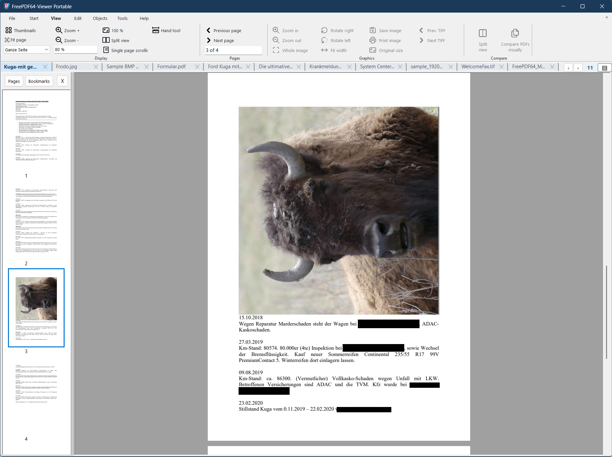
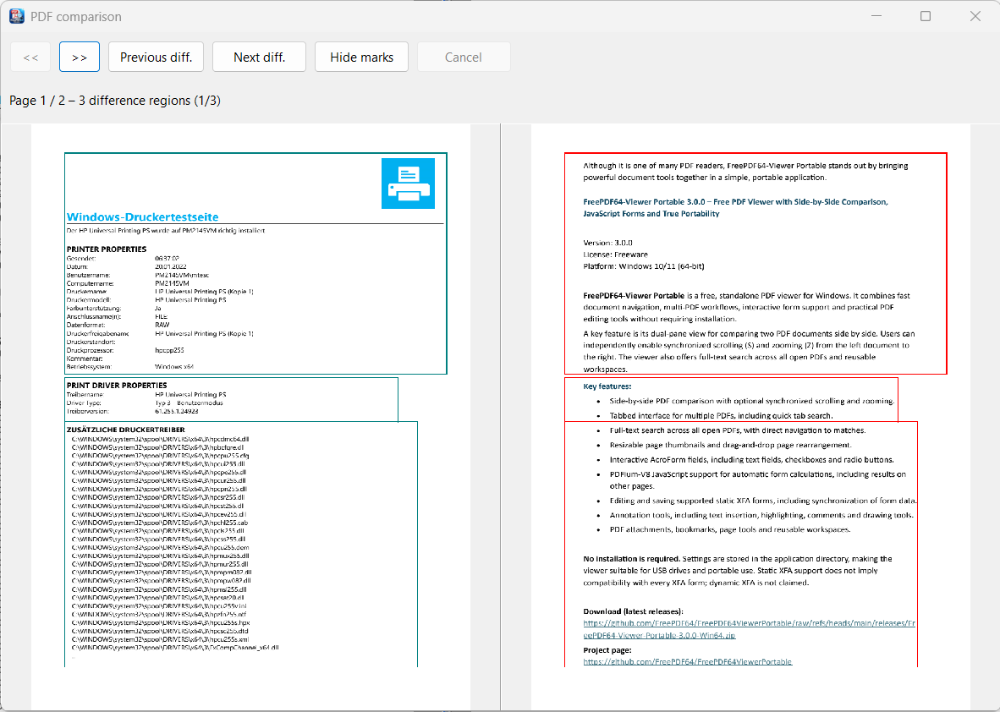
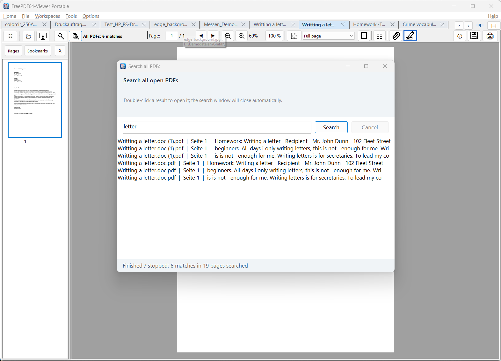
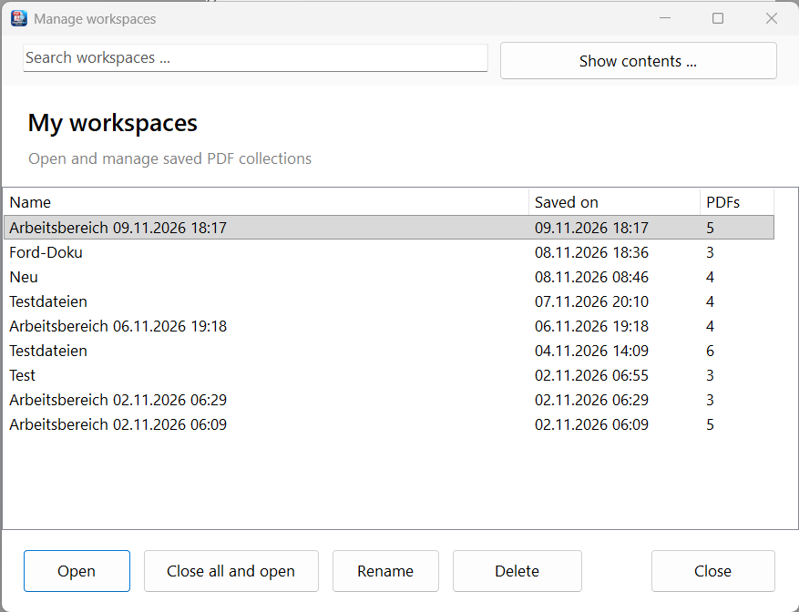
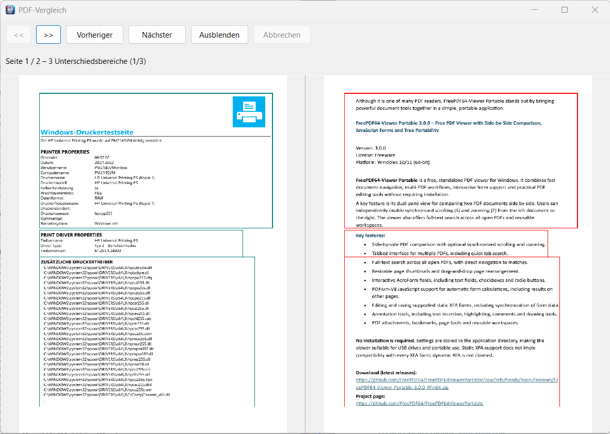
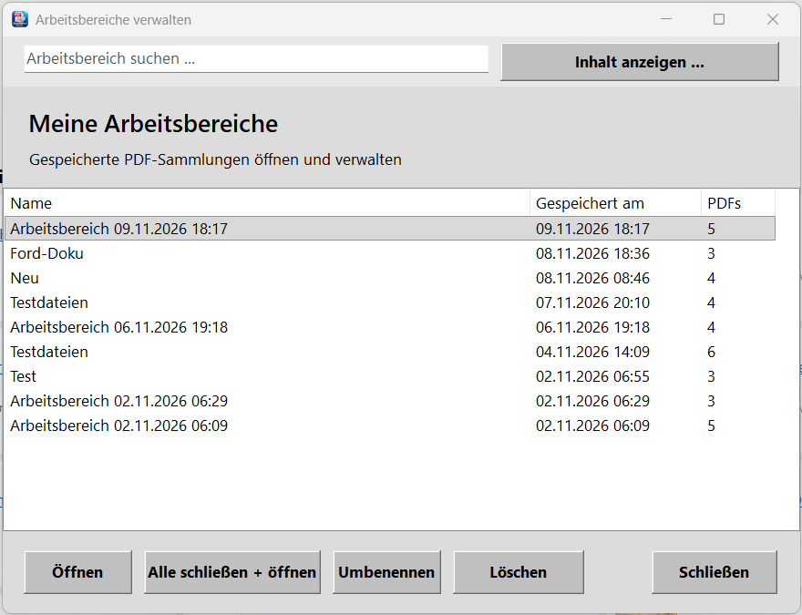

# FreePDF64-Viewer Portable 3.4.1

**Free, open-source PDF and image viewer for Windows – portable, fast and versatile.**

[English](#english) · [Deutsch](#deutsch)

[**Download / Releases**](https://github.com/FreePDF64/FreePDF64ViewerPortable/releases) · [**Projektseite**](https://github.com/FreePDF64/FreePDF64ViewerPortable)

*FreePDF64-Viewer Portable 3.4.1 – redesigned main window and VCL Ribbon. Click to enlarge.*

---

# English

FreePDF64-Viewer Portable is a free, open-source PDF viewer for Windows. It combines a fast PDF and image viewer with tabs, **named, reusable workspaces**, cross-document search, side-by-side viewing, and practical PDF tools. Save a collection of open documents and return to it later instead of reopening every file individually. Settings are stored locally in the application folder.

## New in version 3.4.1

- **Ribbon Interface Improvements:** The Ribbon interface automatically adjusts to the available window width.
- **Edit metadata.**

### New in version 3.4.0

- **Edit existing PDF objects:** Select, move, resize and rotate existing text, image and vector objects (where supported), with a persistent selection outline, live rotation preview, angle display, 15° snapping (Shift), Undo/Redo and one-key Esc exit. Unlike simply adding annotations, this changes existing page objects. A safety check blocks object transformations on pages containing unsupported PDFium object types, helping prevent content loss when saving.
- **Comparison-only split view:** Compare two PDFs side by side, with navigation and zoom targeting the active pane. Editing and ambiguous document actions are disabled; ribbon state and update controls are restored after leaving split view.

- **Redesigned VCL Ribbon:** Replaced the Windows Ribbon Framework with a custom VCL Ribbon. Clearly organized tabs, including **Objects**, provide direct access to viewing, editing, image, and PDF tools. Monochrome Tabler icons are embedded in the executable; no external icon folder is required.
- **Editable PDF zoom percentage:** View the current zoom level in the **View** ribbon, enter a value such as `150 %`, and press Enter to apply it. The display follows zoom changes and switching between open PDFs.
- **Clearer PDF saving:** **Save** (Ctrl+S) writes changes directly to the open PDF; **Save PDF As…** opens a separate dialog. An orange highlight indicates unsaved changes, with a warning when closing modified documents.
- **Redaction controls:** Improved Ribbon access to optical redaction and permanent redaction, including an orange active-tool outline. **Optical redaction only hides content; use permanent redaction to remove it.**
- **Image and multipage TIFF tools:** Reorganized Ribbon commands for image zoom, fit, original size, rotation, saving, and printing, with navigation between pages of multipage TIFFs.
- **Improved editing feedback:** Newly placed PDF hyperlinks can show their target URL as a tooltip before the PDF is saved. Refined Ribbon hover states, button spacing, and tool selection.
- **German/English and high-DPI layouts:** Updated bilingual labels, tooltips, and feature help; refined Ribbon presentation for 4K and WQHD displays.

### Highlights from earlier releases (3.2.0–3.3.0)

- Insert and edit images in PDF pages, including visual multipage TIFF selection.
- Extract embedded PDF images, export complete pages, and view document fonts.
- Use signatures, measurement tools, hyperlink editing, and permanent PDF redaction.
- Benefit from improved PDFium integration, themes, and portable operation.

## Key features

- **VCL Ribbon:** Organized commands with embedded monochrome icons and an editable PDF zoom-percentage field.
- **Tabs and workspaces:** Open multiple PDFs and images in tabs, save named workspaces, and restore collections of documents and their zoom settings.
- **Side-by-side comparison:** View two PDFs together; **S** synchronizes scrolling and **Z** synchronizes zoom (left → right).
- **Search:** Search one PDF or all open PDFs using **Ctrl+Shift+F**.
- **Page management:** Resizable thumbnails; drag and drop pages to reorder, rotate, delete, or extract them.
- **PDF editing:** Move, resize and rotate supported existing text, image and vector objects; insert images, text, comments, drawings, highlights, watermarks, and clickable hyperlinks; Undo/Redo for supported edits.
- **PDF forms:** Edit AcroForm and supported static XFA forms; run supported V8 JavaScript actions and calculations.
- **Images:** Open, zoom, rotate, and save JPG/JPEG, PNG, BMP, and single- or multipage TIFF files; preview and extract embedded PDF images.
- **More:** View PDF font information, manage attachments, export PDF pages as images or text, use bookmarks, switch between German and English, and choose interface themes.

## Workspaces – pick up where you left off

**Workspaces are a standout feature of FreePDF64-Viewer Portable:** Instead of reopening documents one by one, save the currently open PDFs and supported images as a **named workspace** and reopen that collection whenever you need it. This is particularly useful for recurring projects, research, or working with several related documents.

- **Save and restore:** Keep multiple named workspaces and reopen their documents, including saved zoom levels.
- **Manage efficiently:** Search, sort, inspect workspace contents, rename, and delete saved workspaces in a dedicated management window.
- **Portable workflow:** Workspace management is integrated into the viewer, without a separate project-management application.

See the **Workspaces** screenshot below for the management interface.

## Screenshots

*Click a thumbnail to open the full-size image.*

## Quick start

1. Extract the entire release ZIP to a folder, keeping bundled libraries and auxiliary tools.
2. Run **`FreePDF64ViewerPortable.exe`**.
3. Open PDFs using **Ctrl+O**, drag and drop, or Windows File Explorer. Supported image files can also be opened.

**Upgrade note:** The `Xpdf` and `qpdf` folders from older viewer versions are no longer needed by FreePDF64-Viewer Portable and can be deleted from the viewer installation.

**Notes:** Measurements depend on the drawing scale and source PDF. **Visual redaction** only covers content; it does not securely remove it. Not every PDF JavaScript feature or XFA form is supported. Existing-object editing is limited to supported page objects; pages containing unsupported object types are protected from object transformations.

## Portable use and license

Settings are stored in **`FreePDFViewer.ini`** in the application folder.

**FreePDF64-Viewer Portable** is free and open-source software licensed under **GNU GPL v3 (GPL-3.0-only)**. Use, modification, and redistribution are subject to this license. See **`LIZENZ_DE.txt`** (German) and **`LICENSE_NOTICE_EN.txt`** (English).

**Third-party libraries and tools:**
- **[PDFium](https://pdfium.googlesource.com/pdfium/):** PDF rendering and processing, © The PDFium Authors.
- **[V8](https://v8.dev/):** JavaScript engine, © The V8 Project Authors.

License texts and copyright notices for PDFium, V8, and bundled third-party libraries are included in the **`PDFium`** subfolder (**`LICENSE`** file and **`licenses`** directory). Their respective license terms must be observed when redistributing the software. FreePDF64-Viewer Portable is **not an official product of PDFium, V8, or Google**.

**Contact:** [FreePDF64@outlook.com](mailto:FreePDF64@outlook.com) · [GitHub](https://github.com/FreePDF64/FreePDF64ViewerPortable)

---

# Deutsch

FreePDF64-Viewer Portable ist ein kostenloser Open-Source-PDF-Viewer für Windows. Er vereint einen schnellen PDF- und Bildbetrachter mit Registerkarten, **benannten und wiederverwendbaren Arbeitsbereichen**, dokumentübergreifender Suche, Zweifensteransicht und praktischen PDF-Werkzeugen. Zusammengehörige Dokumente lassen sich als Arbeitsbereich speichern und später bequem wieder öffnen. Die Einstellungen bleiben lokal im Programmordner.

## Neu in Version 3.4.1

- **Verbesserungen der Ribbon-Oberfläche:** Die Ribbon-Oberfläche passt sich automatisch an die verfügbare Fensterbreite an.
- **Metadaten bearbeiten.**

### Neu in Version 3.4.0

- **Vorhandene PDF-Objekte bearbeiten:** Vorhandene Text-, Bild- und Vektorobjekte (soweit unterstützt) auswählen, verschieben, skalieren und drehen. Anders als beim bloßen Hinzufügen von Anmerkungen werden bestehende Seitenobjekte verändert. Mit dauerhaftem Auswahlrahmen, Live-Drehvorschau, Winkelanzeige, 15°-Raster (Umschalt), Rückgängig/Wiederholen und Beenden mit einmal ESC. Eine Sicherheitsprüfung verhindert Objekttransformationen auf Seiten mit nicht unterstützten PDFium-Objekttypen und schützt so vor möglichen Inhaltsverlusten beim Speichern.
- **Geteilte Ansicht als Vergleichsmodus:** Zwei PDFs nebeneinander vergleichen; Navigation und Zoom steuern die aktive Teilansicht. Bearbeitung und mehrdeutige Dokumentbefehle sind deaktiviert; Ribbon-Zustände einschließlich Update werden beim Beenden wiederhergestellt.

- **Neu gestaltetes VCL-Ribbon:** Das Windows Ribbon Framework wurde durch ein eigenes VCL-Ribbon ersetzt. Übersichtlich angeordnete Registerkarten, darunter **„Objekte“**, bieten direkten Zugriff auf Anzeige-, Bearbeitungs-, Grafik- und PDF-Werkzeuge. Einfarbige Tabler-Symbole sind direkt in die EXE eingebettet; ein externer Symbolordner ist nicht erforderlich.
- **Editierbare PDF-Zoom-Prozentanzeige:** Den aktuellen Zoomfaktor im Ribbon unter **„Ansicht“** ablesen, einen Wert wie `150 %` eingeben und mit Enter übernehmen. Die Anzeige folgt Zoomänderungen und dem Wechsel zwischen geöffneten PDFs.
- **Übersichtlichere PDF-Speicherung:** **„Speichern“** (Strg+S) schreibt Änderungen direkt in die geöffnete PDF; **„PDF speichern unter …“** öffnet einen eigenen Dialog. Ein orangefarbener Rahmen kennzeichnet ungespeicherte Änderungen; beim Schließen geänderter Dokumente erscheint eine Warnung.
- **Schwärzungswerkzeuge:** Verbesserter Zugriff auf optische und endgültige Schwärzung im Ribbon, einschließlich orangefarbener Aktivmarkierung. **Die optische Schwärzung verdeckt Inhalte nur; zum Entfernen ist die endgültige Schwärzung erforderlich.**
- **Grafik- und mehrseitige TIFF-Werkzeuge:** Neu angeordnete Ribbon-Befehle für Grafikzoom, Einpassen, Originalgröße, Drehen, Speichern und Drucken sowie Navigation durch mehrseitige TIFF-Dateien.
- **Verbesserte Rückmeldungen bei der Bearbeitung:** Neu platzierte PDF-Hyperlinks können ihre Zieladresse bereits vor dem Speichern als Hinweis anzeigen. Überarbeitete Ribbon-Hover-Markierungen, Buttonabstände und Werkzeugauswahl.
- **Deutsch/Englisch und hohe DPI-Auflösungen:** Aktualisierte zweisprachige Beschriftungen, Hinweise und Funktionsübersicht; optimierte Ribbon-Darstellung für 4K und WQHD.

### Highlights früherer Versionen (3.2.0–3.3.0)

- Bilder in PDF-Seiten einfügen und bearbeiten, einschließlich visueller Auswahl mehrseitiger TIFF-Dateien.
- Eingebettete PDF-Bilder extrahieren, ganze Seiten exportieren und PDF-Schriftarten anzeigen.
- Unterschriften, Messwerkzeuge, Hyperlink-Bearbeitung und endgültige PDF-Schwärzung nutzen.
- Verbesserte PDFium-Integration, Designs und portable Nutzung.

## Funktionen im Überblick

- **VCL-Ribbon:** Übersichtlich angeordnete Befehle mit eingebetteten einfarbigen Symbolen und editierbarer PDF-Zoom-Prozentanzeige.
- **Registerkarten und Arbeitsbereiche:** Mehrere PDFs und Bilder in Registerkarten öffnen, benannte Arbeitsbereiche speichern und Dokumente samt Zoom-Einstellungen wiederherstellen.
- **PDF-Vergleich:** Zwei PDFs nebeneinander anzeigen; **S** synchronisiert das Scrollen, **Z** den Zoom (jeweils links → rechts).
- **Suche:** Einzelne PDFs durchsuchen oder alle geöffneten PDFs gemeinsam mit **Strg+Umschalt+F**.
- **Seitenverwaltung:** Vergrößerbare Miniaturen; Seiten per Drag & Drop verschieben, drehen, löschen oder extrahieren.
- **PDF-Bearbeitung:** Unterstützte vorhandene Text-, Bild- und Vektorobjekte verschieben, skalieren und drehen; Bilder, Text, Kommentare, Zeichnungen, Markierungen, Wasserzeichen und anklickbare Hyperlinks hinzufügen; Rückgängig/Wiederholen für unterstützte Bearbeitungen.
- **PDF-Formulare:** AcroForm und unterstützte statische XFA-Formulare bearbeiten; unterstützte JavaScript-V8-Aktionen und Berechnungen ausführen.
- **Bilder:** JPG/JPEG, PNG, BMP sowie ein- und mehrseitige TIFF-Dateien öffnen, zoomen, drehen und speichern; eingebettete PDF-Bilder anzeigen und extrahieren.
- **Weitere Funktionen:** PDF-Schriftarten anzeigen, PDF-Anlagen verwalten, PDF-Seiten als Bilder oder Text exportieren, Inhaltsverzeichnis, DE/EN-Oberfläche und verschiedene Designs.

## Arbeitsbereiche – dort weitermachen, wo du aufgehört hast

**Die Arbeitsbereiche sind ein besonderes Merkmal von FreePDF64-Viewer Portable:** Statt Dokumente jedes Mal einzeln zu öffnen, lassen sich die aktuell geöffneten PDFs und unterstützten Bilder als **benannter Arbeitsbereich** speichern und bei Bedarf gemeinsam wieder aufrufen. Ideal für wiederkehrende Projekte, Recherchen und die Arbeit mit mehreren zusammengehörigen Dokumenten.

- **Speichern und wiederherstellen:** Mehrere benannte Arbeitsbereiche verwalten und die enthaltenen Dokumente einschließlich gespeicherter Zoom-Einstellungen erneut öffnen.
- **Komfortabel verwalten:** Arbeitsbereiche in einem eigenen Fenster durchsuchen, sortieren, Inhalte anzeigen, umbenennen und löschen.
- **Portabel arbeiten:** Die Arbeitsbereichsverwaltung ist direkt in den Viewer integriert – ohne zusätzliches Projektverwaltungsprogramm.

Der Screenshot **Arbeitsbereiche** weiter unten zeigt die Verwaltung.

## Screenshots

*Klicke auf ein Vorschaubild, um die vollständige Ansicht zu öffnen.*

## Schnellstart

1. Release-ZIP vollständig in einen Ordner entpacken; mitgelieferte Bibliotheken und Zusatzprogramme beibehalten.
2. **`FreePDF64ViewerPortable.exe`** starten.
3. PDFs über **Strg+O**, Drag & Drop oder den Windows-Explorer öffnen. Unterstützte Bilddateien können ebenfalls geöffnet werden.

**Hinweis zum Update:** Die Verzeichnisse `Xpdf` und `qpdf` aus älteren Viewer-Versionen werden von FreePDF64-Viewer Portable nicht mehr benötigt und können aus der Viewer-Installation gelöscht werden.

**Hinweise:** Messwerte hängen vom Maßstab und der PDF-Vorlage ab. Die **optische Schwärzung** verdeckt Inhalte nur und entfernt sie nicht sicher. PDF-JavaScript und XFA werden nicht in allen Varianten unterstützt. Die Bearbeitung vorhandener Objekte ist auf unterstützte Seitenobjekte begrenzt; Seiten mit nicht unterstützten Objekttypen sind vor Objekttransformationen geschützt.

## Portabilität und Lizenz

Die Einstellungen werden in **`FreePDFViewer.ini`** im Programmordner gespeichert.

**FreePDF64-Viewer Portable** ist freie und quelloffene Software unter der **GNU GPL v3 (GPL-3.0-only)**. Nutzung, Änderung und Weitergabe richten sich nach dieser Lizenz. Der deutsche Lizenzhinweis steht in **`LIZENZ_DE.txt`**, der englische in **`LICENSE_NOTICE_EN.txt`**.

**Zusatzprogramme und Bibliotheken:**
- **[PDFium](https://pdfium.googlesource.com/pdfium/):** PDF-Darstellung und -Verarbeitung, © The PDFium Authors.
- **[V8](https://v8.dev/):** JavaScript-Engine, © The V8 Project Authors.

Die Lizenztexte und Copyright-Hinweise zu PDFium, V8 und eingebundenen Drittanbieter-Bibliotheken befinden sich im mitgelieferten Unterordner **`PDFium`** (Datei **`LICENSE`** und Ordner **`licenses`**). Bei der Weitergabe sind die jeweiligen Lizenzbedingungen zu beachten. FreePDF64-Viewer Portable ist **kein offizielles Produkt von PDFium, V8 oder Google**.

**Kontakt:** [FreePDF64@outlook.com](mailto:FreePDF64@outlook.com) · [GitHub](https://github.com/FreePDF64/FreePDF64ViewerPortable)

---

Copyright © 2026 FreePDF64

